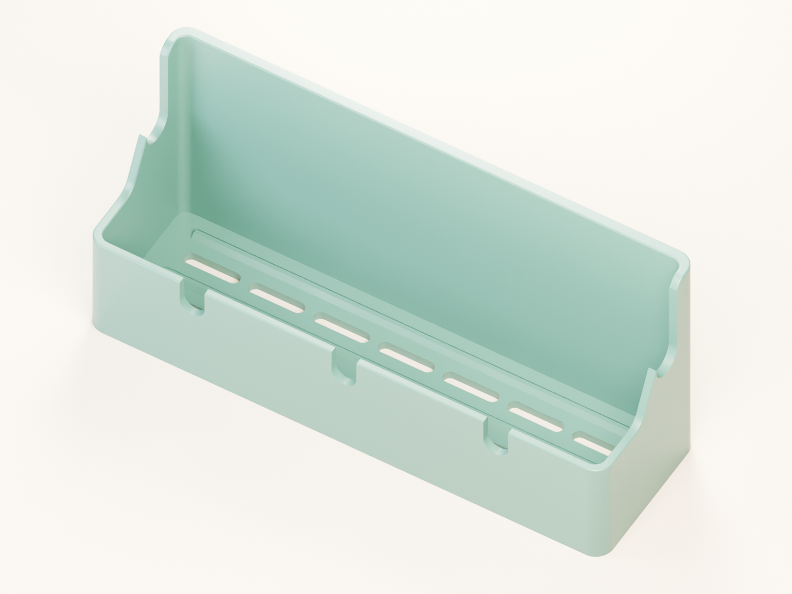
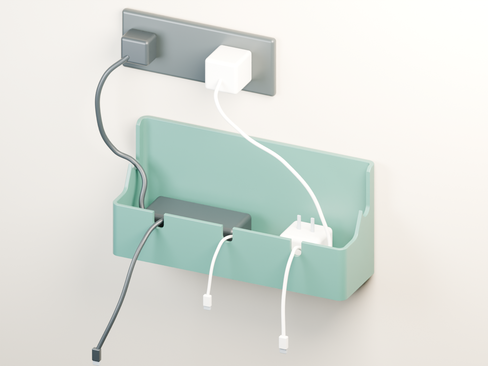

# 床头贴墙充电收纳盒 · V1

> [V5 快打版](v5-rapid/README.md) 薄壁盒和独立斜撑同盘，通用 PLA 无支撑，切片约 1 小时 57 分。
> [V4 三角撑](v4/README.md) 在草图版的盒底增加一体斜撑。
> [V3 草图版](v3/README.md) 按手绘尺寸制作单仓斜口盒。

> [V2 长线收纳方案](v2/README.md) 增加独立的三格理线仓，V1 盒体可继续作为电源仓使用。



一体打印的窄身托盒，装在墙插下方或斜下方。插在墙上的电源头保持原位。盒里收纳独立的电源砖、备用插头和多余线长，常用充电线从前沿落槽引向床侧。开口便于从上方取放，底孔和架高筋给电源砖下方留出空气通道。



## 文件

| 文件 | 用途 |
| --- | --- |
| [X2D PETG 打印项目](printing/bedside-cable-caddy-x2d-petg.3mf) | Bambu Studio 以新项目打开，已排好一盘 |
| [通用 STL](printing/bedside-cable-caddy.stl) | 其他切片器使用，单位 mm，底面朝下 |
| [FreeCAD 源实体](cad/bedside-cable-caddy.FCStd) · [STEP](cad/bedside-cable-caddy.step) | 查看、测量及二次设计 |
| [贴胶定位图](preview/tape-placement.svg) | 从盒背看两条胶的位置，单位 mm |
| [CAD 生成脚本](build.py) | 修改尺寸和特征后重建实体、STEP 与 STL |

## 尺寸和打印前检查

| 项目 | V1 尺寸 |
| --- | --- |
| 外形（宽 × 深 × 高） | **208 × 64 × 98 mm**，深度另加胶带厚度 |
| 盒内 | 直壁段净宽约 201 mm、净深约 56 mm。以 **193 × 50 × 30 mm** 的长方体做过净空检查，线头和弯线需额外留位 |
| 前挡板 | 高 46 mm，三个 10 mm 宽的开口槽，槽底距盒底 32 mm |
| 左右进线 | 各有一个 14 mm 宽的上开口槽，槽底距盒底 58 mm |
| 散热与清理 | 14 个 22 × 5 mm 底孔，三道 1.8 mm 高的支撑筋 |

照片没有比例尺。先量墙面到床沿最窄处、墙上的可用宽度，以及笔记本电源砖连同线头的占位。建议在床和床品正常摆放时量到 **至少约 80 mm** 的墙到床沿净距，并用纸板试一下 208 × 64 mm 的占位，确认床品移动时也碰不到盒子。把适配器放在靠墙一侧，确认线能从插座松弛地绕到侧槽，插拔时手有空间。前槽从上方放入线身即可，接头可以留在槽外。

## 贴墙与使用

1. 选插座下方或侧下方的低位，位于床垫投影外。选择平整、干燥、漆面牢固的位置，避开照片中那类掉漆点。给上方留出取放和插拔的手部空间。
2. 背板贴两条 **25 × 80 mm** 的竖向 3M 双面胶。每条胶的外侧边距相应盒侧 **24.5 mm**，下边距盒底 **9 mm**。两条胶均处于同一平面。选用适用于实际墙面及 PETG 的型号，清洁两面并按胶带说明压合、静置。[3M VHB 表面处理与贴合说明](https://www.3m.com/3M/en_US/bonding-and-assembly-us/resources/full-story/?storyid=b3996cbd-9954-455f-8e72-88e452ca38c0)
3. 静置后在低位逐步试载，检查背板上缘和墙漆是否翘起。换墙面或胶带要重新确认。空盒切片估算约 185 g，安装时把盒体、适配器和线材的总重一起计入。
4. 电源砖放在凸筋上，顶部和底孔留空，余线松松地放在旁边。通电时保持盒子远离被褥，按适配器厂商的通风要求摆放。发热量大的电脑适配器可放在通风的台面上，盒内只收余线。[Apple 电源适配器摆放说明](https://support.apple.com/en-ie/102372)

## 打印及验证

- **X2D / 0.4 mm / Bambu PETG HF / 纹理 PEI**。0.20 mm 层高、4 道墙、15% 填充、5 mm 外侧裙边。底面朝下，开口朝上，无支撑。预计约 **3 小时 29 分，185 g**，为切片估算。
- 已重开 FreeCAD 和 STEP 核对单一闭合实体、安装面、净空和各开口。STL 是单件闭合网格。Bambu Studio 2.9.1.70 已重开 3MF 并完成离线切片，模型在打印区域内，实际生成了裙边路径。
- 第一版尚待实物打印、床边尺寸复核、墙面粘接承载和通电散热验证。取件后检查线槽，去除可能刮线的毛边。

在当前 Mac 的仓库根目录运行以下命令可重建 CAD。较大的尺寸改动应同时复核侧翼曲线、通风孔和走线位置。FreeCAD 文件保存的是可测量和继续加工的实体，尺寸集中在生成脚本里。

```sh
/Applications/FreeCAD.app/Contents/Resources/bin/python bedside-cable-caddy/build.py
```
