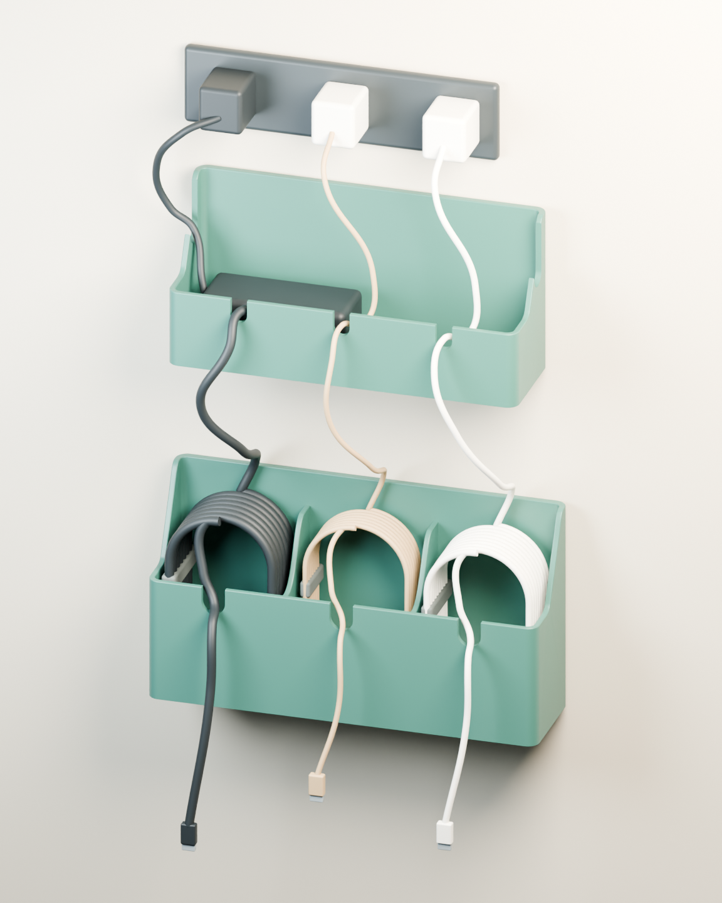
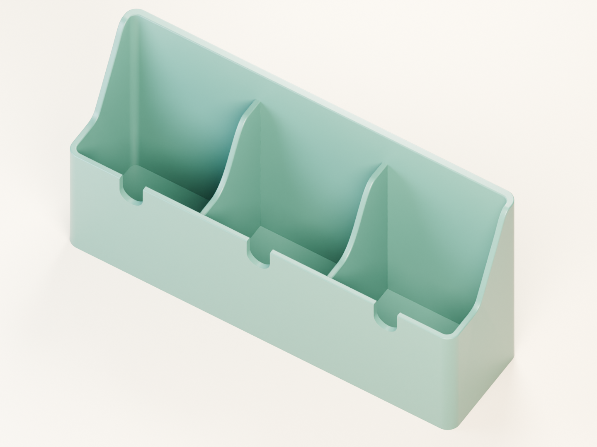

# 床头充电收纳 V2 · 三格长线仓



用两只独立贴墙的盒子分工。上层沿用 [V1 电源盒](../README.md)，下层新增 **232 × 64 × 126 mm** 的长线仓。三格分别收手机、手表和电脑的余线。两只盒子的进深都是 **64 mm**，另加各自的胶厚。

## 长线怎么放

1. **先留够两端。** 插座或电源砖到线仓留一段能自然下垂的线，设备端也留足拉到使用位置的长度。
2. **中间盘成长椭圆。** 盘好后像文件一样竖着插入，一根线一格。椭圆沿墙竖放，圈数从墙面向外叠加。用一条软魔术贴松松束住，便于整束拿起来放线。
3. **供电端走上方，设备端走前槽。** 三格各有一个 14 mm 宽的开口槽，线身从上面放入。需要多放一段时，把该格的线圈提起来解开绑带，放够长度再收回。插拔时握接头，给槽边和接头留一点活动量。[Apple 电源适配器与线材使用说明](https://support.apple.com/en-ca/102193)



## 每格能装多少

直壁处每格约 **73 mm 宽、56 mm 深**。CAD 检查了 **66 × 52 × 112 mm（宽 × 深 × 高）** 的线束可在任意一格竖直放到底。挡板高 74 mm，示例线圈顶部露在前沿上方，方便提取。

| 每格一根线，示例为需要收起的余线长度 | 圈数估算 | 盘好加绑带的占位估算 |
| --- | --- | --- |
| 约 2 m，线径 6 mm | 8 圈 | 66 × 52 × 110 mm |
| 约 3 m，线径 4 mm | 11 圈 | 64 × 48 × 108 mm |

按椭圆线芯中心线 **60 × 104 mm**、两头弯曲半径 **30 mm** 估算，并给绑带留 4 mm 深度。这些数字适用于能自然弯成这个形状的柔性线，接头及两端需要的松弛长度另计。线较粗、较硬或有更大的最小弯曲半径时，以手盘后的尺寸为准。建议打印前按实际需要留出的线长先盘一束，用尺量最宽、最厚、最高处。电脑电源砖留在上层通风位置，市电进线沿外侧保留自然弧度。

## 安装

- **上下装**时，把上盒底和下盒顶之间留约 **85 mm**，给手和线圈留空间，两盒合计约占 **309 mm 高**。也可以左右装，中间留 20 mm 时，合计约 **460 mm 宽**。按实际墙插、床沿和床品位置先试摆。
- 下盒背部有两处 **25 × 90 mm** 的 3M 双面胶平面。每条胶外侧距对应盒边 **23.5 mm**，底端距盒底 **18 mm**。两只盒子各自粘在平整牢固的墙面上，选床垫投影外的低位。确认胶带适用于墙面和 PETG，按说明压合、静置，再逐步试载。下盒空盒切片估算约 **305 g**，试载时计入线材总重。[3M VHB 表面处理与贴合说明](https://www.3m.com/3M/en_US/bonding-and-assembly-us/resources/full-story/?storyid=b3996cbd-9954-455f-8e72-88e452ca38c0)

## 文件与验证

| 文件 | 用途 |
| --- | --- |
| [V2 长线仓 3MF](printing/bedside-cable-tray-x2d-petg.3mf) · [STL](printing/bedside-cable-tray.stl) | 打印新增下盒 |
| [V1 电源盒 3MF](../printing/bedside-cable-caddy-x2d-petg.3mf) | 已经有上盒时，可直接沿用 |
| [FreeCAD](cad/bedside-cable-tray.FCStd) · [STEP](cad/bedside-cable-tray.step) · [生成脚本](build.py) | 查看、测量和调整 |

3MF 已用 Bambu Studio 重开并切片验证。配置为 **X2D / 0.4 mm / Bambu PETG HF / 0.20 mm / 4 道墙 / 5 mm 外侧 Brim**，底朝下、无支撑。长线仓预计约 **5 小时 4 分、305 g**。CAD 与 STL 已检查闭合、胶区和线束净空。容量为几何估算，实物盘线、墙面承载及床边安装仍待验证。

在仓库根目录运行以下命令可重建长线仓 CAD。

```sh
/Applications/FreeCAD.app/Contents/Resources/bin/python bedside-cable-caddy/v2/build.py
```
