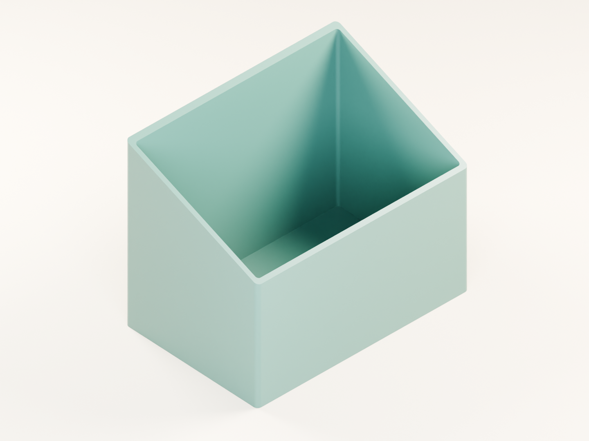

# 床头斜口盒 · 草图版 V3



草图里等高的 **15 cm** 边作为沿墙的宽度，**10 cm** 边作为离墙的进深。靠墙背板高 **12 cm**，前挡板高 **8 cm**，两侧上沿直线连接。顶部敞开，适配器和余线从上面一起放进单仓，线可直接跨过前沿。

外形尺寸为 **150 × 100 mm**，直壁间净宽约 **144 mm**、净深约 **93 mm**。背板厚 4 mm，侧壁和前壁厚 3 mm，底厚 3.4 mm，四个竖角为小圆角。

## 打印与安装

- [X2D PETG 打印项目](printing/bedside-slope-box-x2d-petg.3mf) · [通用 STL](printing/bedside-slope-box.stl)
- [FreeCAD](cad/bedside-slope-box.FCStd) · [STEP](cad/bedside-slope-box.step) · [生成脚本](build.py)

X2D / 0.4 mm / PETG HF 已重开项目并完成无支撑切片。底面朝下，0.20 mm 层高、4 道墙，切片估算约 **3 小时 59 分、225 g**。已核对四个外部尺寸、取放开口和贴胶面，实物试装和承载待验证。

打印前在床边比一下 **100 mm 加胶厚** 的实际占位，并给开口上方留出手伸入的空间。背面两条 **25 × 85 mm** 的竖向贴胶区，距两边各 15.5 mm、距底 16 mm。选床垫投影外的低位和平整牢固的墙面，按所选 3M 胶带的说明贴合、静置后再逐步试载。[3M 胶带贴合说明](https://www.3m.com/3M/en_US/bonding-and-assembly-us/resources/full-story/?storyid=b3996cbd-9954-455f-8e72-88e452ca38c0)

开口留给取放和走线。通电的适配器要保持周围通风，余线放在一旁。[Apple 电源适配器使用说明](https://support.apple.com/en-gb/102193)

在仓库根目录运行以下命令重建 CAD。

```sh
/Applications/FreeCAD.app/Contents/Resources/bin/python bedside-cable-caddy/v3/build.py
```
