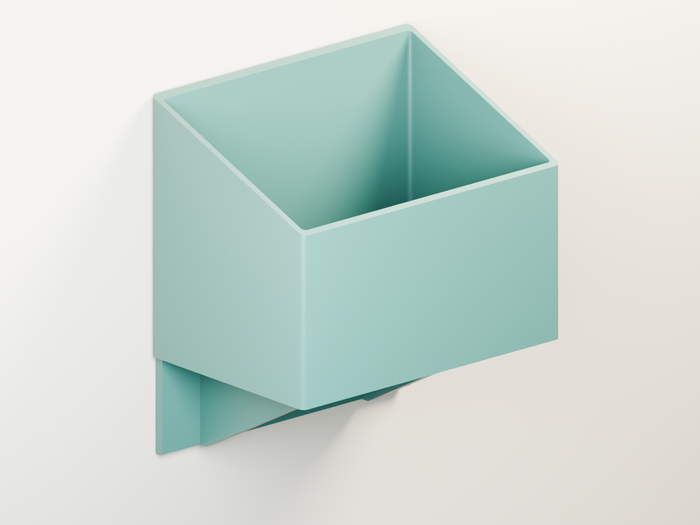

# 床头斜口盒 · V4 三角撑



在 V3 的盒底加两条一体成型的三角撑。每条 **厚 6 mm**，从墙面向前伸到距墙 **90 mm** 的位置。靠墙背板向下延 **45 mm**，把下部受力点移低。盒口仍是后高 120 mm、前高 80 mm，盒内取放空间沿用 V3。含斜撑的外形为 **150 × 100 × 165 mm**（宽 × 深 × 高）。

[侧视和贴墙位置示意](preview/side-profile.svg)

## 贴墙

上方两条 **25 × 85 mm** 胶带，下方延长板上两条 **25 × 35 mm** 胶带。四条胶带用同一种、同一厚度的 3M 双面胶，每条外边距对应盒侧 15.5 mm。上胶区底端在盒底以上 16 mm，下胶区底端距延长板最下缘 5 mm。CAD 已确认四处共面。

盒子受重时有向外翻的趋势。上下受力点隔得更开，在相同翻转力矩下有助于减小把上缘掀开的力。这个效果取决于下胶区也能贴实。选床垫投影外的低位和平整牢固的墙面，按胶带说明压合、静置，再逐步试载。实际承载仍待实测。[3M 胶接结构设计指南](https://www.3m.com/3M/en_US/bonding-and-assembly-us/resources/full-story/?storyid=a7373207-e0e3-4498-84ef-f749d380e910)

## 文件

- [X2D 打印项目](printing/bedside-braced-box-x2d.3mf) · [STL](printing/bedside-braced-box.stl)
- [FreeCAD](cad/bedside-braced-box.FCStd) · [STEP](cad/bedside-braced-box.step) · [生成脚本](build.py)

X2D / 0.4 mm / Generic PLA 已重开并切片。项目选用通用 PLA 耗材预设。后背延长板下缘朝下，0.20 mm 层高、4 道墙、5 mm 外侧 Brim。盒底和斜撑下方使用从热床生长的树状支撑，预计 **10 小时 8 分、306 g**（含支撑）。取件后拆掉支撑和 Brim，确认贴墙面平整。

从仓库根目录重建 CAD。

```sh
/Applications/FreeCAD.app/Contents/Resources/bin/python bedside-cable-caddy/v4/build.py
```
