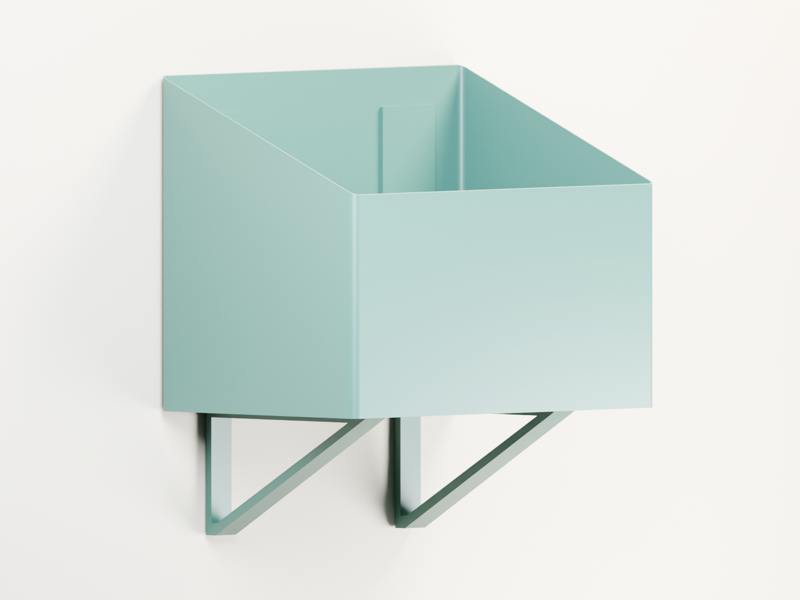

# 床头斜口盒 · V5 快打版



[X2D PLA 快打 3MF](printing/bedside-rapid-box-x2d-pla.3mf) · [整盘 STL](printing/bedside-rapid-box.stl) · [FreeCAD 装配](cad/bedside-rapid-box.FCStd) · [STEP](cad/bedside-rapid-box.step)

**整盘切片总估时 1 小时 57 分 18 秒，约 72 g，无支撑。** 盒体和两条斜撑同盘。X2D、0.4 mm、Generic PLA、0.28 mm 层高、Arachne 单道壁、12 mm³/s 流量上限。以新项目打开 3MF 即可载入排盘和设置。实际用时取决于设备与耗材。

## 结构和安装

盒体沿墙宽 150 mm，向外深 100 mm，后沿高 120 mm，前沿高 80 mm。速度版用 0.60 mm 薄壁，贴胶位置加厚。盒底厚 1.12 mm，内侧有横向加强筋。两条三角撑平打，装好后从盒底向下 45 mm，向前伸 84 mm。

1. 盒背用两条 **25 × 85 mm** 的 3M 双面胶。两胶带中心分别离盒左右侧边 **28 mm**，胶带下端距盒底 **16 mm**。
2. 把两条撑各贴在对应胶带中心线的下方。斜撑 **45 mm 竖边贴墙，84 mm 横边紧贴盒底**。撑背每条胶区 **10 × 35 mm**，贴胶下端距斜撑最低处 5 mm。四处使用同厚度的胶，让撑顶与盒底贴紧。
3. 胶带按产品说明压合、静置后，在床垫投影外的低位逐步试载。这是薄壁轻载版，实物打印和墙面承载待验证。

模型已核对三件闭合实体、四处平整胶区和两处盒底接触。3MF 已重开切片并检查薄壁挤出路径和无支撑排盘。

[生成脚本](build.py) 在仓库根目录可用 FreeCAD 自带 Python 运行。

```sh
/Applications/FreeCAD.app/Contents/Resources/bin/python bedside-cable-caddy/v5-rapid/build.py
```
