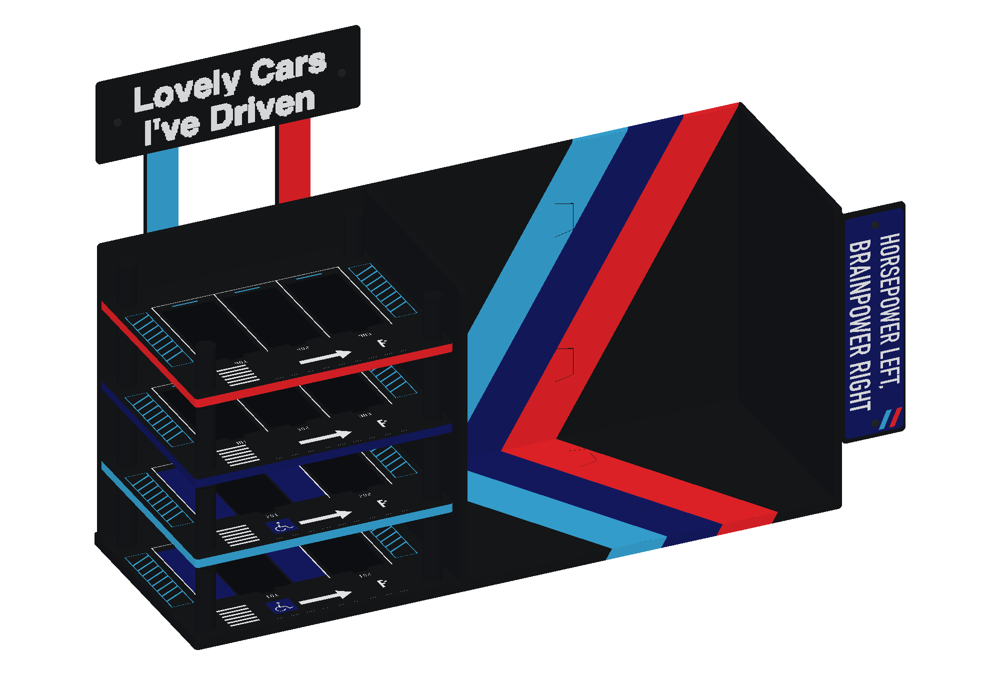
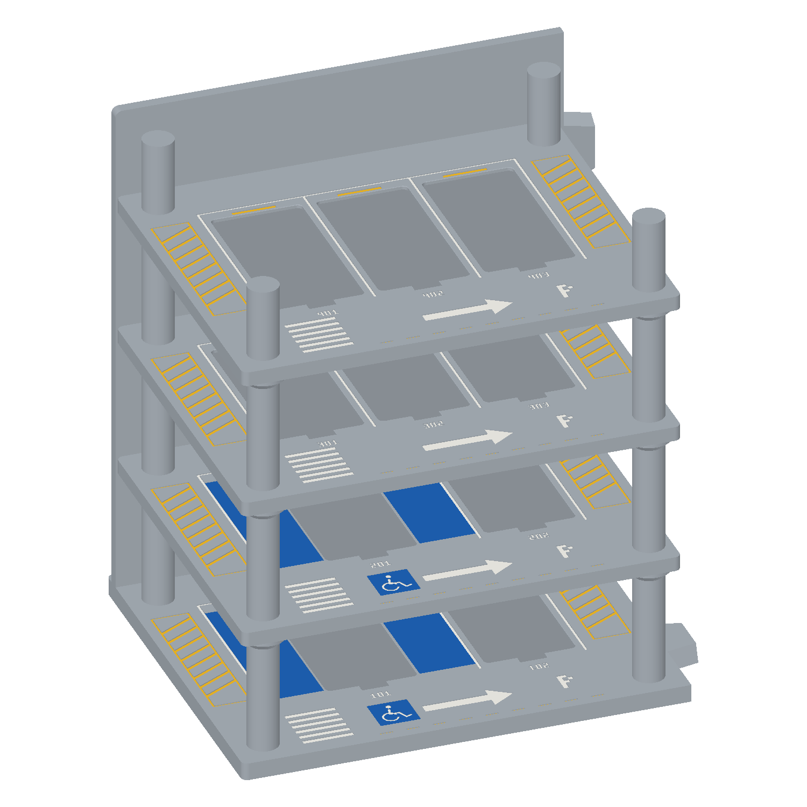
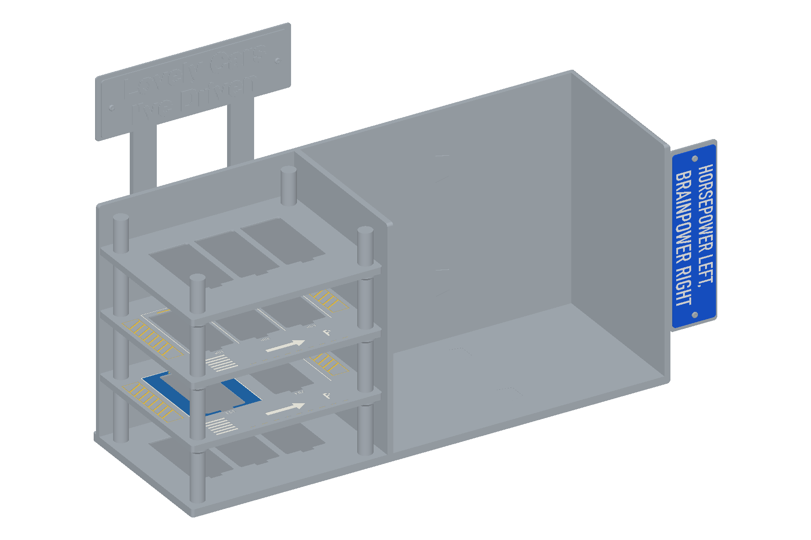
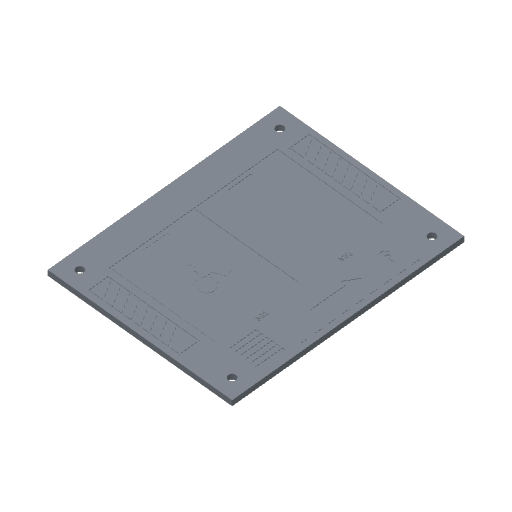
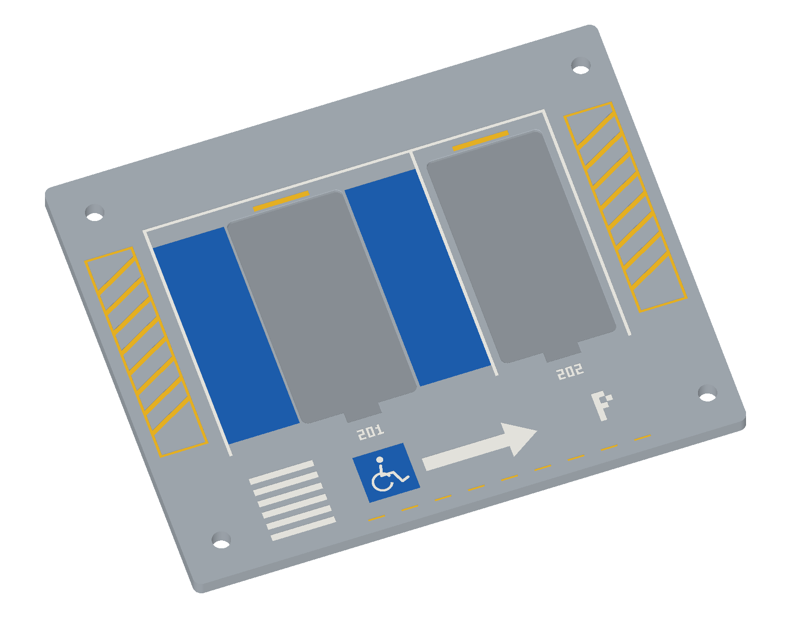
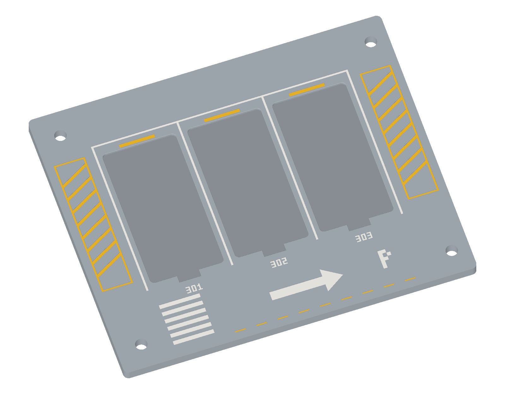
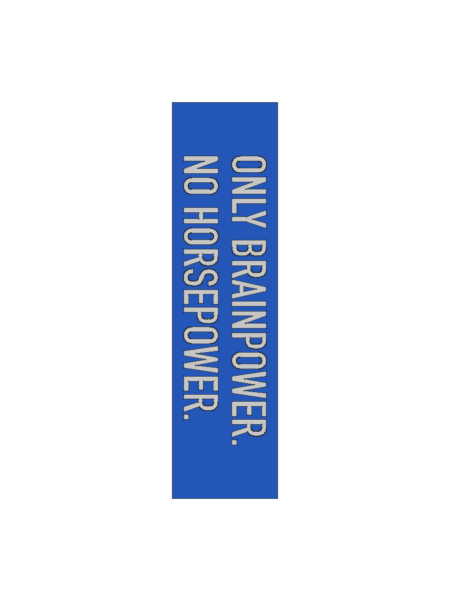

# garage-bookshelf v4 · 49 cm 紧凑版

**M Power 黑色配色（2026-10-26）：** 已将确认方案保存到正式 `garage-bookshelf-v4-assembly.FCStd`。主体、立柱和停车面为黑色；三块悬空层板的外缘自下而上为浅蓝、深蓝、红色；横牌为黑底白字、不带三色标，左/右支架正面为浅蓝/红色；右侧口号牌为深蓝底白字。书架三色带在背板、底板及顶边/前沿连续衔接，三条共用 **36 mm 实际宽度**，比例严格为1∶1∶1。可在 `MColorParameters` 表的 `StripeWidth` 修改，宽度沿板面垂直色带方向测量。三色带以全约束草图、原表面引用和原生面布尔交集保存为零厚度外观面；0.01mm仅用于显示避闪，不是板材或色带厚度。**35个原有Body的实体、定位、接头、圆角、槽位和字形均保留**。备份为 `backups/2026-10-26-before-mpower-colors.FCStd`；验证见 `reports/mpower-color-validation.json`，配色明细及维护方法见 [COLOR_SCHEME.md](COLOR_SCHEME.md)。本轮未重导STEP/STL/3MF/ZIP，外观面不作为打印实体导出。旧图中的灰/黄配色是历史状态。



[FreeCAD直接导出的预览](reports/mpower-freecad-preview.png) · [正面](reports/mpower-front-preview.png) · [等宽三色带局部](reports/mpower-stripe-detail.png)

**四层停车装饰（2026-10-25）：** 已将确认的浅槽装饰应用到正式CAD：第1层来自 `module_1` 主体底板，第2/3/4层分别来自 `garage_deck_1/2/3`。四层依次为 **2/2/3/3 bay，共10个托座槽**；前两层左侧为约 **94.076 mm** 宽的无障碍车位，右侧为约 **47.038 mm** 宽的普通车位，上两层均为47.038mm普通车位。各槽仍采用统一40.6×80.6mm主体轮廓、1.6mm深度及前端取放口，双车位槽按新车位中心调整。编号依次为 **101–102、201–202、301–303、401–403**；编号前移2mm，轮椅标识放在前方18×18mm蓝色区域，无障碍车位两侧保留蓝色带。白/黄凹刻0.4mm、蓝底0.2mm，装饰不进入槽底；底层槽底6.4mm、三块层板槽底5mm。原F接头、可拆字牌、外露圆角、柱段与外包络保留。增量入口 `update_parking_decoration.py`，检查见 `reports/four-floor-decoration-validation.json`。本轮仅更新正式CAD与预览，不重导STEP/STL/3MF/ZIP；下列11槽及旧打印记录为历史状态。



[第1层（主体底板）](reports/four-floor-decoration-floor-1.png) · [第2层（层板1）](reports/four-floor-decoration-floor-2.png) · [第3层（层板2）](reports/four-floor-decoration-floor-3.png) · [第4层（层板3）](reports/four-floor-decoration-floor-4.png)

**停车托座浅槽（2026-10-25）：** 正式CAD采用无磁铁落入式接口。三块悬空层板总厚 **6.6 mm**，槽深 **1.6 mm**，槽底保留 **5 mm**；底板维持8mm，开槽后底厚6.4mm。统一槽主体 **40.6 × 80.6 mm、R2.3**，匹配40 × 80mm、R2托座底脚，单边名义间隙0.3mm；入口0.2mm小倒角、前端12 × 4mm局部取放缺口。底层/双车位层/三车位层/顶层分别 **3/2/3/3槽，共11槽**。12个承托柱段高改为56.4mm、顶销长9.6mm，三层板底面Z=64.4/127.4/190.4mm，板外侧顶面仍为71/134/197mm；柱顶230mm不变。名义板间净高为56.4mm。保留F组接头、可拆字牌、口号及已有R3轮廓圆角。CAD内另有默认隐藏的通用底脚与取放耳样件，**不含按车型适配的轮胎夹**。修改入口为 `update_parking_recesses.py`，检查见 `reports/parking-recesses-validation.json`。本轮不重导STEP/STL/3MF；下文旧打印、切片和预览数据为历史记录。完整重建脚本仍未涵盖全部字牌、口号和外观增量，不可覆盖正式CAD。

**右侧字牌文字（2026-10-24）：** 正式 CAD 已改为全大写 **HORSEPOWER LEFT, BRAINPOWER RIGHT**。保留两列竖排、顺时针90°、自上而下阅读：左列 **BRAINPOWER RIGHT**，右列 **HORSEPOWER LEFT,**（转正阅读时，HORSEPOWER在上、BRAINPOWER在下）。保留可拆字牌、螺孔、0.4 mm凹刻深度与R3圆角；本次未重导打印文件。修改入口为 `update_side_slogan.py`，检查见 `reports/side-slogan-validation.json`。

**外露轮廓圆角（2026-10-24，已确认保留）：** 仅修改三段主体、三块停车层板、广告牌及一体支架、上方可换字牌、右侧牌座和字牌。选定外露轮廓角采用 R3 mm，支架底端采用 R2 mm；未对所有棱边统一倒圆，立柱、文字、停车图案和外购金属件保持原状。拼接边保持齐平，F组榫卯配合面和层板承托面积保持不变。正式CAD已添加原生可编辑 Fillet 特征；本次修改脚本为 `round_exposed_corners.py`，检查见 `reports/exposed-corners-validation.json`。旧完整重建脚本尚不包含这版外观调整，不可直接覆盖当前正式CAD。STEP、STL及旧3MF预览不代表本轮试改结果。

**正式CAD接头采用F组配合（2026-10-23）：** 主体两处拼接界面的底板、背板母槽统一采用名义总侧隙0.3 mm；公榫长14 mm，母槽总深14.2 mm。母槽的前14 mm保持与公榫一致的插入方向锥度，槽尾另作0.2 mm等截面延伸。仅更新现有正式FCStd及建模源代码，保留可拆字牌、螺丝和其他零件；未重新导出STEP、STL、3MF或预览。当前CAD检查见 `reports/F-fit-cad-validation.json`；下文旧的导出/切片验证均为历史结果。F组实物选择来自背板接头小样，底板接头仅完成几何检查。

**打印文件已清理（2026-10-23）：** 当前 v4 的 3MF 和打印 ZIP 已删除，待 CAD 定稿后重新生成。正式工程为 `garage-bookshelf-v4-assembly.FCStd`；下文打印清单、切片数据与验证结果保留为历史记录，当前状态见 [PRINT_STATUS.md](PRINT_STATUS.md)。

**最新字牌方案：** [可抽换字牌套件](removable-signs/README.md)。上方两行合为一片、右侧口号另用一片，均采用倒扣燕尾插拔字牌；完整装配、打印套件及试配小样在该目录。下文保留原固定文字方案的尺寸与打印记录。

本次将书架段从 340 mm 缩短至 290 mm（减少 50 mm），两块书架模块各从 170 mm 缩短至 145 mm；车库段仍为 200 mm。

v4 按本次尺寸要求重新设计，所有产物在本目录。保留 v3 的三层停车布局、主体与广告牌高度、灰色主体/黄色立柱/黑底白字/蓝牌外观；车库层板与广告牌均改为整块，不再使用左右拼片和跨缝片。

蓝牌按参考图外挂在右侧板外边，朝向使用者（−Y），不占放书开口。**490 mm 仅指车库与书架主体，蓝牌外伸 48 mm 另计，含蓝牌最大总长为 538 mm。** 蓝牌自带一体折边，贴在右侧板外表面粘接。两根广告牌支架仍位于背板后方：底板保持 170 mm 深，背板后表面为 Y=164，支架占 Y=164…170，总深为 170 mm。



[三车位浅槽局部](reports/parking-recesses-deck-2.png) · [通用底脚样件落座预览](reports/parking-tray-interface.png)。预览直接取自正式CAD实体；底脚样件不含车型轮胎夹。

## 尺寸（mm）

| 项目 | v4 |
| --- | ---: |
| 主体总长，不含外挂蓝牌 | **490** |
| 外挂蓝牌外伸宽度 | **48** |
| 含蓝牌最大总长 | **538** |
| 车库段占地 | **200** |
| 书架段占地，包含隔板与右侧板 | **290** |
| 总深，包含背板、广告牌与文字 | **170** |
| 主体高，沿用 v3 | **238** |
| 含广告牌总高，沿用 v3 | **364** |
| 书架内净长 / 净深 / 背板前净高 | 278 / 159 / 230 |
| 底板 / 背板 / 侧板厚 | 8 / 5 / 6 |
| 每块停车层板 | **195.6 × 158.6 × 6.6** |
| 层板总厚 / 托座槽深 / 槽底厚 | **6.6 / 1.6 / 5**，底面平整、无下垂加强梁 |
| 三块层板底面 Z | **64.4、127.4、190.4** |
| 层距，沿用 v3 | **63** |
| 两层板间名义净高 | **56.4**，从未下凹的板顶面计 |
| 底板至第一层板名义净高 | **56.4** |
| 整块广告牌 | **200 × 64 × 6**，底面 Z=300 |
| 外挂蓝牌正面 | **48 × 180**，厚 2；一体折边总深 14 |

290 mm 书架段是外部分区尺寸，已经计入 X=200…206 的隔板和 X=484…490 的右侧板，所以净长为 278 mm。隔板与右侧板底部的四处 RootRib 三角肋已移除，底部放书空间保持平整。层板四根柱中心为 X=14、186，Y=14、145，中心距 172 × 131；实际停车空间还需扣除柱体。未将“约 20 / 29 cm”错误地当成两段净空后再额外加板厚。

## 车库板可以整块一盘打印

附图给出的主喷嘴范围为 256 × 256 × 260 mm，辅助喷嘴/双喷嘴交集为 235.5 × 256 × 256 mm。本版按**较小的 235.5 × 256 × 256 mm**检查每个打印件，X/Y 各额外预留两侧 4 mm brim。

- 每层车库板为一个封闭实体、一个 STL，没有中缝、拼接燕尾或跨缝加强片。层板1为双车位，层板2为三车位，层板3空白；三盘分别打印一次。
- 每层板实际打印包络 **195.6 × 158.6 × 5 mm**；加 brim 后为 **203.6 × 166.6 mm**。
- 车库底板与背板也合成一个完整 L 形主体，连外伸公榫的打印包络约 **213.8 × 170 × 238 mm**；加 brim 后约 **221.8 × 178 mm**，同样一盘。
- 广告牌也是一整块 200 mm 长板，放平打印；广告牌、支架和白字全部收进 170 mm 深度以内。



## 停车层板右边缘避让修正

三块停车层板仅从靠书架的右边缘额外收短 **4 mm**，宽度由199.6 mm变为 **195.6 mm**。左边缘、四个Ø6.5圆孔、立柱与车库主体的位置保持不变；不采用整体缩放或左右对称裁边。参数表新增 `DeckRightTrim=4 mm`，深度158.6 mm与厚度5 mm不变。CAD名义左边间隙仍为0.2 mm，右边间隙为4.2 mm；实物缩进还取决于原有装配偏移。停车图案随新宽度调整。

右侧托环会比板边伸出约0.2 mm，几何检查要求仍保留至少99%的原承托面积；此次修改尚未实物试装。

## 停车层板图案

- **第1层，主体模块1底板**：2 bay，101为左侧宽车位（94.076mm，轮椅标识），102为右侧普通车位（47.038mm）；2个统一托座槽。
- **第2层，整块停车层板1**：2 bay，201/202，宽度及左右布局同底层；2个统一托座槽。
- **第3层，整块停车层板2**：3 bay，301/302/303，每格47.038mm；3个统一托座槽。
- **第4层，整块停车层板3**：3 bay，401/402/403，每格47.038mm；3个统一托座槽。

槽外布局使用 [`decoration/recessed_layout.py`](decoration/recessed_layout.py) 中确认的白色停车线、编号、斑马线、右行箭头和黄色侧边禁停斜线。编号前移2mm，取放口与编号间净距约3.6mm；双车位前方18×18mm蓝区保留轮椅图案，槽两侧为蓝色带。槽外白/黄图案为 **0.4 mm** 原生 Pocket 凹刻，蓝底为 **0.2 mm**；托座槽深1.6mm，底层槽底6.4mm、三块悬空层板槽底 **5 mm**，不在槽底叠加图案凹刻。底面、定位孔和支承区保留。CAD白/黄/蓝色表示可选填色，较深的灰色用于识别槽底，均不代表额外零件或多色打印设置。




## 右侧蓝牌口号

**HORSEPOWER LEFT, BRAINPOWER RIGHT**，正面朝使用者。两句话各保持完整一行，再顺时针旋转 90°，成为并排两列，均从上往下读：左列 **BRAINPOWER RIGHT**，右列 **HORSEPOWER LEFT,**（转正阅读时，HORSEPOWER在上、BRAINPOWER在下）。以下固定蓝牌尺寸、凹刻与打印参数为历史记录；当前正式可拆字牌以本页顶部更新及验证报告为准。

蓝牌收窄为 **48 × 180 mm**。两句统一字高 **16 mm**，旋转后每列宽 16 mm，中间净距 **6 mm**，左右边距各 **5 mm**。句长约 **119.8 / 131.3 mm**；两列顶部对齐，最长一列上下余量各约 **24.4 mm**。28 个字形分别建立原生 Sketch，再经 SubShapeBinder 汇总为一个 Pocket，凹刻深 **0.6 mm**，2 mm 面板保留 **1.4 mm** 背厚，不增加零件数量。

蓝牌保持单件打印。CAD 预览中的白字表示**凹槽填白漆的效果**；STL 和当前单 PLA 的 3MF 不会自动生成白色耗材分配。打印后可填白，或在切片软件另行配置多色涂色。无需逐字打印再粘贴。



## 文件入口

- **`garage-bookshelf-v4-assembly.FCStd`**：完整原生参数化 FreeCAD 装配，46 个独立 Body；243张完全约束草图（含63张停车图案草图），Sketch、Pad、Pocket、Loft 和 Spreadsheet 可编辑。实际草图数量见 `reports/validation.json`。
- **`garage-bookshelf-v4-assembly.step`**：毫米单位、46 个实体、保留完整装配位置的通用 STEP。已重新导入检查总尺寸。
- **`print-stl/`**：28 个按逻辑件导出的打印朝向、归零 STL。三块层板与各柱段按装配名称分别保留，便于定位；重复件只需按下表取代表文件打印。
- `stl/`：同样 28 个文件，采用**装配全局坐标**，用于装配对照；直接打印请用 `print-stl/`。
- **`bambu-projects/`**：11 个按颜色分盘的 X2D / 标准 0.4 mm 喷嘴 / PLA 的 Bambu Studio 3MF 项目。每个保存后的 3MF 均已重新加载并直接切片通过，验证时不覆盖其配置，不含打印 G-code。
- **`garage-bookshelf-v4-X2D-print-3mf.zip`**：11 个 3MF、逐盘预览、打印清单及装配参考图的完整交付包；解压后以「打开项目」方式加载 3MF。
- **`bambu-projects/README.md`**、`bambu-projects/print-manifest.json`：逐盘颜色、数量、次数、时间/耗材估算和 SHA256。
- `print-profiles/`：解析完整继承与 include 模板后的 X2D、PLA 和工艺预设，以及官方安装文件来源哈希。
- `reports/validation.json`：实体、草图、两处模块滑入路径、层板下落路径、承托面积、参数改动/恢复、保存重开、STL 封闭/非流形/尺寸检查。
- `reports/bom.json`、`reports/parameters.json`：完整零件清单与参数定义。
- `slicer-validation.json`：11 个保存后 3MF 的实际重开切片结果、项目和源 STL 哈希、颜色、设置、时间与耗材估算。
- `reports/package-validation.json`：保存的 3MF 排盘坐标、对象数量、打印盘次和交付文件 SHA256。
- `reports/assembly-preview.png`、`reports/front-preview.png`、`reports/rear-preview.png`、`reports/blue-sign-preview.png`：从真实 FreeCAD 工程渲染的装配/正视/背视图及蓝牌特写。

## 打印清单

01a、01b、01c 分别对应三块不同的层板，各打印一次；不要再使用旧的 `print-three` 项目。05、06 盘已分别摆好全部 12 个承托柱段和 4 个封顶柱段。

| 3MF 项目 | 每盘内容 | 打印盘数 | 总数量 |
| --- | --- | ---: | ---: |
| `01a-garage-deck-1-two-bays` | 层板1：双车位，B01轮椅标识 | 1 | 1 块 |
| `01b-garage-deck-2-three-bays` | 层板2：三车位 | 1 | 1 块 |
| `01c-garage-deck-3-plain` | 层板3：空白整板 | 1 | 1 块 |
| `02-garage-base` | 200 mm 车库底背一体模块 | 1 | 1 |
| `03-book-left` | 145 mm 书架左模块，含隔板 | 1 | 1 |
| `04-book-right` | 145 mm 书架右模块，含右侧板 | 1 | 1 |
| `05-support-segments-twelve` | 12 个相同的承托柱段 | 1 | **12** |
| `06-top-segments-four` | 4 个封顶柱段 | 1 | **4** |
| `07-billboard-and-posts-black` | 黑色整块广告牌与两根背面支架 | 1 | 3 块 |
| `08-billboard-lettering-white` | 白色两行文字，共 20 个字形岛 | 1 | 20 岛 |
| `09-blue-slogan-sign` | 蓝色外挂凹刻口号牌 | 1 | 1 块 |

全套共 11 次打印盘作业、46 个实体。文字的两个 STL 各包含 10 个分离字形；保留字间位置打印后，按装配图逐字粘贴。

所有 3MF 使用 0.20 mm 层高、4 圈墙、25% 填充、4 mm auto brim，按标准 0.4 mm 喷嘴、PLA、纹理 PEI 板配置。官方 PLA 预设为喷嘴 220°C、纹理板 55°C。03 盘（书架左模块）为燕尾悬臂启用普通自动支撑、仅从热床生成；其余盘关闭支撑。

各项目已分别保存灰、黄、黑、白或蓝色的单一 PLA 配置，不需要 AMS 或多色换料。灰色01a/01b/01c及02–04盘，黄色05–06盘，黑色07盘，白色08盘，蓝色09盘。蓝牌口号凹刻面朝热床、折边朝上，文字在首0.6 mm；白字外观通过打印后凹槽填白实现。

在 Bambu Studio 中选择「打开项目」，保留其排盘与项目预设。按实际机器确认喷嘴、耗材和热床后重新切片，即可进入打印流程；未连接或发送任务到打印机。

STL 代表件：`garage_deck_1.stl`、`garage_deck_2.stl`、`garage_deck_3.stl` 各1块，`column_1_segment_1.stl` ×12、`column_1_segment_4.stl` ×4；两根广告牌支架已包含在07盘，蓝牌在09盘。其余对象各一次。不要同时把上述代表件数量和所有同名组内的独立 STL 全部再打印一次。

## 接口和装配顺序

v4 改掉了 v3 连续柱穿过无孔层板的实体干涉：层板现在有四个 Ø6.5 定位通孔，柱顶销为 Ø6，单侧径向间隙 0.25；柱底定位盲孔 Ø6.5、深 3.3。层板由 Ø20 托环承托，销只负责定位。每根柱由三个 **56.4 mm** 承托段和一个33mm封顶段组成；前三段另带 **9.6 mm** 长顶销，穿过6.6mm层板后仍插入上段3mm。底板有四个高3mm的一体定位销。

1. 先干装三段主体：车库模块在左，带隔板的模块在中，右侧板模块在右。后两段分别从右向左（−X）同步滑入底板与背板的四组燕尾。燕尾槽名义总侧隙 0.4 mm。先清理 03 盘的支撑、燕尾表面和象脚，再干装确认；模块接缝必须坐平、背板对齐后，再按胶水说明粘接并充分固化。
2. 将四个承托柱段套到底板定位销上，柱底落在 Z=8 的底板面。
3. 第一块双车位层板通过四个孔自上而下套到柱顶销，底面落在 **Z=64.4** 的托环上。层板底面平整，浅槽朝上，总厚 **6.6 mm**。
4. 将第二组四段柱的底孔套在露出层板的销上，再放第二块层板（底面 **Z=127.4**）；重复安装第三组柱和第三块层板（底面 **Z=190.4**）。
5. 最后安装四个 33 mm 封顶段，顶面 Z=230。先完成整套干装，再逐层粘牢柱底、托环接触面及定位接口；不要仅靠松配定位销承担侧向稳定。
6. 两根广告牌支架放在 X=38、138，Y=164，Z=150；支架前表面贴住车库背板的后表面 Y=164，沿 24 × 88 mm 接触面粘牢。支架延伸到 Y=170，全部位于背板后方；牌底与支架顶面在 Z=300 接触，再粘接牌与白字。广告牌从 Y=164 起布置，文字朝前。层板后缘不再开支架避让槽。
7. 蓝牌位于右侧板外边：正面占 X=490…538、Y=0…2、Z=50…230，48 × 180 mm 的大面朝向使用者（−Y）。一体折边占 X=490…492、Y=2…14、Z=50…230，与正面连成一个打印件。将牌左侧的整个 14 × 180 mm 贴合面粘到右侧板外表面 X=490，名义接触面积 2520 mm²。蓝牌与折边均在主体外侧，放书开口内没有凸入部分；右侧板前端原来的蓝牌凹位已取消。蓝牌外伸 48 mm 不计入主体 490 mm 长度。

层板与隔板、背板各留0.2mm边隙，右侧另有4mm裁边；支架位于背面，层板不需要后缘支架槽。停车层板为 **6.6mm厚、1.6mm浅槽、槽底5mm** 的平底无梁整板，保留四孔与四个托环支承。当前可拆字牌及其锁定结构以本页顶部更新和正式CAD为准。

## 停车层板抗弯计算

历史计算按未凹刻的5 mm整板、每层三辆车模及多美卡裸车称重记录作载荷参考。三辆各100 g、含整实体自重的假设工况下，预计最大下挠约0.065 mm；更不利的600 g集中中部、等效E=500 MPa场景约0.351 mm。**这些数值不包括本次0.2/0.4 mm浅凹刻的影响，不能直接作为带图案层板的计算结果。** 材料等效模量是计算假设，尚未完成实物或长期蠕变验证。

完整报告、分析过程、图表、脚本、原始数值与冻结的有梁参考 CAD，集中保存在独立目录 [`analysis/parking-deck-bending/`](analysis/parking-deck-bending/README.md)。正式装配和打印文件均为无梁版；参考 CAD 仅用于复现原计算。

## 验证范围

已完成：46 个有效单实体、原有草图及新增停车图案草图全约束、全部零件两两布尔干涉为零；另检查蓝牌正面法向为 −Y、蓝牌及折边位于 X≥490 且与放书开口零交叠、与右侧板外表面有 2520 mm² 胶接面、两根支架的前表面与背板后表面贴合；主体接缝按 30/15/5/1/0 mm 采样验证共同 −X 滑入；每块层板按 12/8/3/0 mm 采样验证下落，均避开当前已安装的柱和主体。12 个托环的有效承托接触面积各约 280.98 mm²。四组真实参数修改/恢复通过，保存重开通过，STEP 重新读入后主体 490 × 170 × 238 mm、含装饰件 538 × 170 × 364 mm 与实体数量通过。另检查口号完整字符串、两列旋转字形位于牌面内、实际凹刻体积、剩余背厚及改变牌宽后仍居中。所有 28 个打印 STL 封闭、无非流形，11 个保存后的 3MF 均在不另加 STL、不覆盖预设的条件下重新加载并切片通过、无模型切片警告；已另外解析保存的 3MF，检查对象数量及其带 brim 的实际排盘坐标。

这些是几何、接口和切片验证。**尚未实际打印、试配或加载测试，没有额定承重结论。** 首次使用应先确认销孔与燕尾实物配合，胶水固化后逐步进行预期车模和书本载荷测试，尤其观察层板下挠、粘接和整体侧向稳定。

## 编辑与重建

在 FreeCAD 中打开 FCStd，双击 `DesignParameters` 修改 B 列 `input`，再重算。派生参数为公式；改变 `GarageWidth` 会同时调整层板、柱位置、广告牌与书架两段长度；`OverallWidth` 表示不含蓝牌的主体长度，`OverallEnvelopeWidth` 表示包含外挂蓝牌的最大长度；`SignX` 自动跟随右侧板外表面。改变 `OverallDepth` 会同步调整背板、层板与后柱。`SignWidth` 控制蓝牌宽度并保持口号水平居中；`SignTextHeight` 控制统一字高，`SignColumnGap` 控制列间距；两列作为整体水平居中、顶部对齐，并按最长句自动垂直居中，`SignEngraveDepth` 控制凹刻深度。参数适用于当前三主体/三层/四柱拓扑，极端值或零件数量变化需重新设计。

本地完整重建：

```sh
cd /Users/kai.han/code/3d-designs/garage-bookshelf/v4
/Applications/FreeCAD.app/Contents/Resources/bin/python main.py
python3 make_print_projects.py
python3 check_package.py
```

`main.py` 重建并检查 CAD、STEP 与 STL；`make_print_projects.py` 解析已安装 Bambu Studio 的 X2D / PLA 预设的全部继承及模板，重新生成11个按颜色分盘的3MF，重开每个项目直接切片验证，并自动打包 ZIP。`package_print_projects.py` 可从已验证结果单独重打交付包。脚本自包含，不依赖 v1/v2/v3 脚本或安装原字形字体。左侧广告牌文字轮廓采用本目录冻结的 v3 字形掩码；右侧口号采用冻结的 DIN Condensed Bold 轮廓，重建无需安装原字体。

本次缩短书架后执行 `python3 make_print_projects.py --only 03-book-left 04-book-right 09-blue-slogan-sign`，重建并重开切片两块书架项目及随右侧板移动的蓝牌导出项目；其余项目复用前次切片验证，逐项核对源 STL 和项目 SHA256。已保留本地用户修改过的 `bambu-projects/05-support-segments-twelve.3mf`；完整 ZIP 与同名解压目录继续使用已验证的标准 05 盘。

无 GUI 重建后，可在 FreeCAD Python 控制台执行以下命令，恢复配色、隐藏中间特征并重出预览：

```python
import sys
sys.path.insert(0, '/Users/kai.han/code/3d-designs/garage-bookshelf/v4')
import gui_review
gui_review.run()
```

`validate_export.py` 可以单独重新打开已编辑的 FCStd 进行检查/导出，但最终整机尺寸断言仍针对本次 主体 490 × 170 × 238 mm、含蓝牌及广告牌 538 × 170 × 364 mm 交付；若有意修改总尺寸，请相应更新断言。v1、v2、v3 不会被生成脚本改写。
