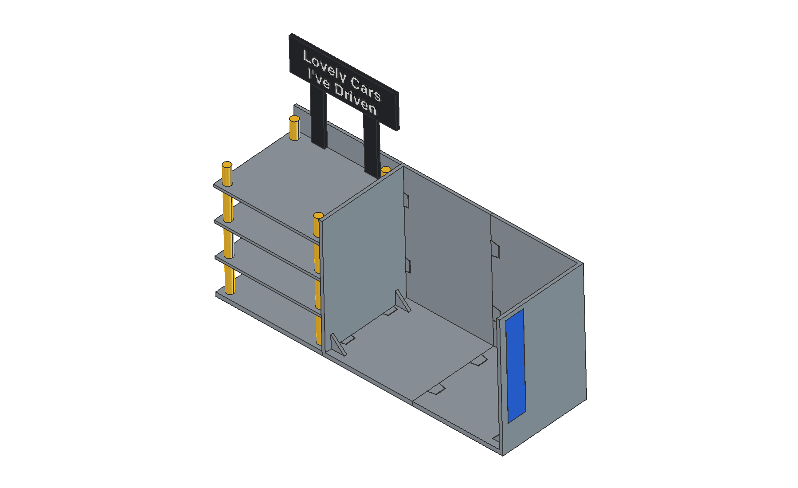
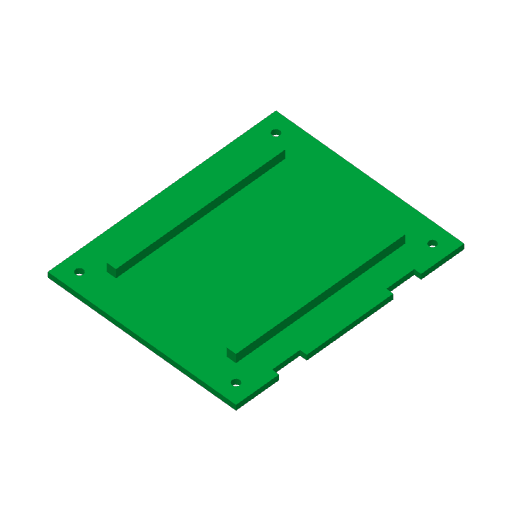

# garage-bookshelf v4 · 54 cm 紧凑版

v4 按本次尺寸要求重新设计，所有产物在本目录。保留 v3 的三层停车布局、主体与广告牌高度、灰色主体/黄色立柱/黑底白字/蓝侧牌外观；车库层板与广告牌均改为整块，不再使用左右拼片和跨缝片。



## 尺寸（mm）

| 项目 | v4 |
| --- | ---: |
| 总长，包含侧牌 | **540** |
| 车库段占地 | **200** |
| 书架段占地，包含隔板与右侧板 | **340** |
| 总深，包含背板、广告牌与文字 | **170** |
| 主体高，沿用 v3 | **238** |
| 含广告牌总高，沿用 v3 | **364** |
| 书架内净长 / 净深 / 背板前净高 | 328 / 165 / 230 |
| 底板 / 背板 / 侧板厚 | 8 / 5 / 6 |
| 每块停车层板 | **199.6 × 164.6 × 5** |
| 层板连同一体加强梁的总厚 | **13**（板面 5 + 下垂梁 8） |
| 三块层板底面 Z，沿用 v3 | **66、129、192** |
| 层距，沿用 v3 | **63** |
| 两层板间净高 | 普通区域 58；加强梁下 50 |
| 底板至第一层板净高 | 普通区域 58；加强梁下 50 |
| 整块广告牌 | **200 × 64 × 6**，底面 Z=300 |

340 mm 书架段是外部分区尺寸，已经计入 X=200…206 的隔板和 X=534…540 的右侧板，所以净长为 328 mm。板根三角加强肋在局部占用书架底部空间。层板四根柱中心为 X=14、186，Y=14、151，中心距 172 × 137；实际停车空间还需扣除柱体。未将“约 20 / 34 cm”错误地当成两段净空后再额外加板厚。

## 车库板可以整块一盘打印

附图给出的主喷嘴范围为 256 × 256 × 260 mm，辅助喷嘴/双喷嘴交集为 235.5 × 256 × 256 mm。本版按**较小的 235.5 × 256 × 256 mm**检查每个打印件，X/Y 各额外预留两侧 4 mm brim。

- 每层车库板为一个封闭实体、一个 STL，没有中缝、拼接燕尾或跨缝加强片。三层完全相同；每层一盘，打印三次。
- 每层板实际打印包络 **199.6 × 164.6 × 13 mm**；加 brim 后为 **207.6 × 172.6 mm**。
- 车库底板与背板也合成一个完整 L 形主体，连外伸公榫的打印包络约 **213.8 × 170 × 238 mm**；加 brim 后约 **221.8 × 178 mm**，同样一盘。
- 广告牌也是一整块 200 mm 长板，放平打印；广告牌、支架和白字全部收进 170 mm 深度以内。



## 文件入口

- **`garage-bookshelf-v4-assembly.FCStd`**：完整原生参数化 FreeCAD 装配，46 个独立 Body，162 张完全约束草图；Sketch、Pad、Pocket、Loft 和 Spreadsheet 可编辑。
- **`garage-bookshelf-v4-assembly.step`**：毫米单位、46 个实体、保留完整装配位置的通用 STEP。已重新导入检查总尺寸。
- **`print-stl/`**：28 个按逻辑件导出的打印朝向、归零 STL。三块层板与各柱段按装配名称分别保留，便于定位；重复件只需按下表取代表文件打印。
- `stl/`：同样 28 个文件，采用**装配全局坐标**，用于装配对照；直接打印请用 `print-stl/`。
- **`bambu-projects/`**：8 个 X2D / 0.4 mm 喷嘴 / PLA 的 Bambu Studio 3MF 项目。对应的 8 组 STL 已按 3MF 相同配置离线切片通过，不含打印 G-code。
- `reports/validation.json`：实体、草图、两处模块滑入路径、层板下落路径、承托面积、参数改动/恢复、保存重开、STL 封闭/非流形/尺寸检查。
- `reports/bom.json`、`reports/parameters.json`：完整零件清单与参数定义。
- `slicer-validation.json`：8 组同源 STL 的对象数、输入哈希、切片设置、警告和时间估算。
- `reports/package-validation.json`：保存的 3MF 排盘坐标、对象数量、打印盘次和交付文件 SHA256。
- `reports/assembly-preview.png`、`reports/front-preview.png`：从真实 FreeCAD 工程渲染的装配/正视图。

## 打印清单

3MF 文件名中的 `print-three` 表示需要重复打印该盘三次，盘里只有一块完整层板。05、06 盘已分别摆好全部 12 个承托柱段和 4 个封顶柱段。

| 3MF 项目 | 每盘内容 | 打印盘数 | 总数量 |
| --- | --- | ---: | ---: |
| `01-whole-garage-deck-print-three` | 一块整片层板，梁朝上 | **3** | 3 块 |
| `02-garage-base` | 200 mm 车库底背一体模块 | 1 | 1 |
| `03-book-left` | 170 mm 书架左模块，含隔板 | 1 | 1 |
| `04-book-right` | 170 mm 书架右模块，含右侧板 | 1 | 1 |
| `05-support-segments-twelve` | 12 个相同的承托柱段 | 1 | **12** |
| `06-top-segments-four` | 4 个封顶柱段 | 1 | **4** |
| `07-billboard-and-lettering` | 整块广告牌与两行文字（共 20 个字形岛） | 1 | 1 板 + 20 岛 |
| `08-posts-and-blue-sign` | 两根广告牌支架与蓝色嵌牌 | 1 | 3 |

全套共 10 次打印盘作业、46 个实体。文字的两个 STL 各包含 10 个分离字形；保留字间位置打印后，按装配图逐字粘贴。

所有 3MF 使用 0.20 mm 层高、4 圈墙、25% 填充、4 mm auto brim、关闭支撑。项目保留单个 PLA 材料预设；07 盘的黑底/白字、08 盘的黑支架/蓝侧牌需在 Bambu Studio 按对象指定所用颜色，或分开按颜色打印。CAD 配色只表示装配外观，不会自动变成切片耗材分配。

首次在 Bambu Studio 打开 3MF 后，请确认当前实际喷嘴/耗材映射并重新切片查看预览；离线检查使用相同源 STL 和预设，未连接打印机读取硬件状态。

STL 代表件：`garage_deck_1.stl` ×3、`column_1_segment_1.stl` ×12、`column_1_segment_4.stl` ×4；左右广告牌支架相同，但 08 盘已经包含两根。其余对象各一次。不要同时把上述代表件数量和所有同名组内的独立 STL 全部再打印一次。

## 接口和装配顺序

v4 改掉了 v3 连续柱穿过无孔层板的实体干涉：层板现在有四个 Ø6.5 定位通孔，柱顶销为 Ø6，单侧径向间隙 0.25；柱底定位盲孔 Ø6.5、深 3.3。层板由 Ø20 托环承托，销只负责定位。每根柱由三个 58 mm 承托段和一个 33 mm 封顶段组成；前三段另带 8 mm 长顶销。底板有四个高 3 mm 的一体定位销。

1. 先干装三段主体：车库模块在左，带隔板的模块在中，右侧板模块在右。后两段分别从右向左（−X）同步滑入底板与背板的四组燕尾。燕尾槽名义总侧隙 0.4 mm。模块接缝必须坐平、背板对齐后，再按胶水说明粘接并充分固化。
2. 将四个承托柱段套到底板定位销上，柱底落在 Z=8 的底板面。
3. 第一块层板通过四个孔自上而下套到柱顶销，底面落在 Z=66 的托环上。梁在下方、平整停车面在上方。
4. 将第二组四段柱的底孔套在露出层板的销上，再放第二块层板（底面 Z=129）；重复安装第三组柱和第三块层板（底面 Z=192）。
5. 最后安装四个 33 mm 封顶段，顶面 Z=230。先完成整套干装，再逐层粘牢柱底、托环接触面及定位接口；不要仅靠松配定位销承担侧向稳定。
6. 两根广告牌支架放在 X=38、138，Y=159，Z=150；上层板后缘的两个开槽避让支架。支架后表面与车库背板前表面贴合，沿接触面粘牢；牌底与支架顶面在 Z=300 接触，再粘接牌与白字。支架通过槽位前，应先干装定位广告牌部件。
7. 将蓝牌粘入右侧板的外表面凹槽，外侧与 X=540 齐平；蓝牌边缘留 0.2 mm 胶缝，不增加总长。

层板与隔板、背板各留 0.2 mm 边隙；两个后缘支架槽也留 0.2 mm 单侧间隙。层板整片下方有两条 8 × 8 mm 梁，长 148 mm，无任何分体加强件。支架、广告牌、文字和主体燕尾均采用胶接思路，没有额外螺钉。

## 验证范围

已完成：46 个有效单实体、162 张草图全约束、全部零件两两布尔干涉为零；主体接缝按 30/15/5/1/0 mm 采样验证共同 −X 滑入；每块层板按 12/8/3/0 mm 采样验证下落，均避开当前已安装的柱和主体。12 个托环的有效承托接触面积各约 280.98 mm²。两组真实参数修改/恢复通过，保存重开通过，STEP 重新读入后总尺寸与实体数量通过。所有 28 个打印 STL 封闭、无非流形，8 组 STL 均按 3MF 相同配置离线切片通过、无切片警告；已另外解析保存的 3MF，检查对象数量及其带 brim 的实际排盘坐标。

这些是几何、接口和切片验证。**尚未实际打印、试配或加载测试，没有额定承重结论。** 首次使用应先确认销孔与燕尾实物配合，胶水固化后逐步进行预期车模和书本载荷测试，尤其观察层板下挠、粘接和整体侧向稳定。

## 编辑与重建

在 FreeCAD 中打开 FCStd，双击 `DesignParameters` 修改 B 列 `input`，再重算。派生参数为公式；改变 `GarageWidth` 会同时调整层板、柱位置、广告牌与书架两段长度；`OverallWidth` 维持整机长度。改变 `OverallDepth` 会同步调整背板、层板、后柱与后梁。参数适用于当前三主体/三层/四柱拓扑，极端值或零件数量变化需重新设计。

本地完整重建：

```sh
cd /Users/kai.han/code/3d-designs/garage-bookshelf/v4
/Applications/FreeCAD.app/Contents/Resources/bin/python main.py
python3 make_print_projects.py
python3 check_package.py
```

`main.py` 重建并检查 CAD、STEP 与 STL；`make_print_projects.py` 使用已安装 Bambu Studio 的 X2D 预设重新生成并离线切片 3MF。脚本自包含，不依赖 v1/v2/v3 脚本或重新采样字体。CAD 文字轮廓采用本目录冻结的 v3 字形掩码。

无 GUI 重建后，可在 FreeCAD Python 控制台执行以下命令，恢复配色、隐藏中间特征并重出预览：

```python
import sys
sys.path.insert(0, '/Users/kai.han/code/3d-designs/garage-bookshelf/v4')
import gui_review
gui_review.run()
```

`validate_export.py` 可以单独重新打开已编辑的 FCStd 进行检查/导出，但最终整机尺寸断言仍针对本次 540 × 170 × 364 mm 交付；若有意修改总尺寸，请相应更新断言。v1、v2、v3 不会被生成脚本改写。
