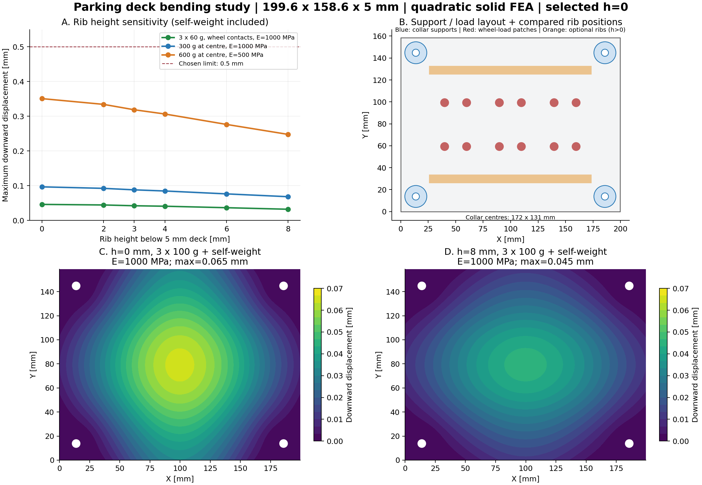

# 停车层板加强梁高度计算 · 每层三辆多美卡

结论：**在当前 5 mm 厚层板、四个托环正确安装并胶接、常温静载的计算假设下，最低额外梁高为 0 mm。** 推荐无梁、保留 5 mm 面板作为首件试打印方案。现有 8 mm 梁能减小下挠，但对于三辆普通多美卡小车的计算载荷，没有必要保留到这个高度。

本目录保存完整计算报告、分析过程、对比图、数值与复现脚本。根据计算结论，正式 v4 FreeCAD、STEP、STL、3MF 已更新为 5 mm 厚无梁版。计算使用的原 8 mm 梁 CAD 冻结在 `reference/`，其计算前后 SHA256 一致，记录在 `summary.json`；正式模型与 h=0 计算几何的对应验证见 `design-application.json`。这不是实物承重认证。

## 载荷参考

普通多美卡轿车不能只凭 1:64 比例推定重量。厂商页面未找到所需的裸车重量，因此使用收藏者逐车称重原始记录作参考，而非把包装/快递重量当车重：

| 参考车型 | 记录的本体重量 | 记录来源 |
| --- | ---: | --- |
| No.50 GT-R Racing Car | 37 g | [收藏者 No.41–50 原始记录](https://www.tcp-ip.or.jp/~katagawa/tomicaZeppan41-50.htm) |
| No.43 MINI Cooper | 54 g | [同上，记录区分本体与含包装重量](https://www.tcp-ip.or.jp/~katagawa/tomicaZeppan41-50.htm) |
| No.52 Toyota GR Corolla | 40 g | [收藏者 No.51–60 原始记录](https://www.tcp-ip.or.jp/~katagawa/tomicaZeppan51-60.htm) |

这些是个别藏品记录，不是所有多美卡的重量上限或厂家公差。选 **60 g/辆、三辆共 180 g** 作参考场景；另按 **100 g/辆、三辆共 300 g** 校核。大型工程车、长车或带底座的组合应实际称重后更新载荷。

层板自重按完整实体体积 × 1.24 g/cm³ 计算：无梁约 **195 g**，8 mm 梁约 **219 g**。当前切片为 25% 填充，实际打印件通常更轻；这里保留整实体自重，以免漏掉自重或把填充率直接当成零件重量比例。

## 几何和支承

- 从冻结的 v4 有梁参考 CAD 读取：整片 199.6 × 158.6 × 5 mm，4 个 Ø6.5 通孔。
- 四个 Ø20 托环，中心距 X=172、Y=131 mm。局部坐标中心为 (13.8,13.8)、(185.8,13.8)、(13.8,144.8)、(185.8,144.8) mm。
- 两条一体梁宽 8 mm、长 148 mm；从板底向下的高度分别计算 0、2、3、4、6、8 mm。h=0 直接采用加梁前的原生 Pocket 实体，并非把无效的零长度 Pad 当几何。
- 只约束托环环形接触区底面的竖向位移；额外用两处最小面内约束消除刚体运动。**没有把四条整边固定。** 支承按已胶接的刚性托环处理，未模拟松配晃动、柱/胶层柔度、翘曲导致的脱空或胶接失效。
- 梁没有直接延伸到柱轴心；CAD 实体网格保留真实梁端、孔与板的传力关系，不把它替换成一根满跨度的等截面梁。

## 材料假设

[拓竹 PLA Basic 官方 TDS V3.0](https://cdn.shopify.com/s/files/1/0584/7236/6216/files/Bambu_PLA_Basic_Technical_Data_Sheet_bf3411ce-be39-4db7-9669-1b4671d2196b.pdf?v=1734060943) 给出密度 1.24 g/cm³、XY 弯曲模量约 2750 MPa；其试样是 **100% 填充，且测试前在 55°C 处理 8 小时**。这些值不能直接当成当前 25% 填充、未作同样处理的零件性能。

主计算采用各向同性等效 **E=1000 MPa、泊松比 0.35**，再把 E 降为 **500 MPa** 作敏感度校核。它们是人为选取的较低刚度假设，不是已测出的 25% 填充材料参数，也不是某一使用年限后的模量。模型没有显式重建填充、外墙和表皮路径。

只针对普通室内常温静置展示。没有根据本次线弹性计算预测热环境、数年蠕变或疲劳寿命。[PLA 弯曲蠕变原始研究](https://arxiv.org/abs/2302.11240)表明，低于玻璃化温度的长期变形仍需考虑，不能把下表短期值直接当成多年后的数值。

## 计算方法和验证

使用 Gmsh 4.15.0 将精确 CAD 划分成二次四面体 C3D10，CalculiX 2.23 作小变形线弹性求解。分别求自重、单位 1 N 车轮载荷、单位 1 N 中部载荷，再在节点位移场上叠加后取最大值。

三车排列的车中心 X=50、99.8、149.6 mm，Y=79.3 mm；假设轮距 20 mm、轴距 40 mm，各轮用半径 4 mm 的小接触区分配节点力。这些停车位置是计算布置，不是某款多美卡的尺寸实测。另将全部车重集中到板中央的小接触区，作更不利的中部载荷场景。

每辆 m g 时，三辆车的总载荷 P=3m/1000×9.81 N。例如 100 g/辆对应 P=2.943 N；无梁板自重约 1.917 N。

同一几何、载荷和泊松比下，线弹性位移按 1000/E 成比例缩放。因此 E=500 MPa 场景的位移为 E=1000 MPa 结果的两倍；没有把这个倍数当成实测蠕变系数。

6 mm 网格扫描全部梁高；4 mm 网格复核 h=0、3、8 mm，约 3.4–3.5 万节点、1.7 万个二次四面体。两种网格在检查场景下的最大结果差为 **1.36%**。体积积分与 CAD 体积、单位载荷与支座反力平衡均作校验；自重平衡最大相对误差为 **2.92e-06**。处理自重时，按 [CalculiX 官方手册](https://www.dhondt.de/ccx_2.23.pdf)对 RF 中包含的支座节点等效体力作了扣除。

## 结果：最大向下挠度（mm）

所有列都计入相应梁高的层板自重。0、3、8 mm 取细网格结果，其余取 6 mm 网格；显示到 0.001 mm 仅为结果比较精度，不代表实物可预测到微米。

| 额外梁高 h | 三辆×60g，按轮载 | 三辆×100g，按轮载 | 300g 集中中部 | 600g 集中中部，E 降至500MPa | 层间最小净高 |
| ---: | ---: | ---: | ---: | ---: | ---: |
| 0 | 0.046 | 0.065 | 0.097 | 0.351 | 58 |
| 2 | 0.044 | 0.062 | 0.092 | 0.334 | 56 |
| 3 | 0.042 | 0.059 | 0.088 | 0.319 | 55 |
| 4 | 0.041 | 0.057 | 0.085 | 0.306 | 54 |
| 6 | 0.037 | 0.051 | 0.076 | 0.277 | 52 |
| 8 | 0.032 | 0.045 | 0.068 | 0.248 | 50 |

本次自选 **0.5 mm** 为外观/使用挠度目标，而非引用某项结构标准。选型最不利场景为：三辆各 100 g 的车重再乘 2（共 600 g）、集中在板中央，材料等效刚度再减半；无梁结果约 **0.351 mm < 0.5 mm**。因此在已计算 h≥0 的范围，最小满足高度就是 **h=0 mm**。

常规参考场景的无梁结果约 **0.046 mm**，8 mm 梁约 **0.032 mm**，差约 0.014 mm。3 mm 梁约 0.042 mm；对这一载荷，保留小梁带来的绝对改善也很有限。

作为名义应力量级交叉检查，可暂把整板看成宽 158.6 mm 的简支条带：L=172 mm，t=5 mm，中部 P=2.943 N，自重均布总载 W=1.917 N。M=P·L/4+W·L/8≈167.8 N·mm；Z=b·t²/6≈660.8 mm³，名义弯曲应力约 **0.25 MPa**。这是整板平均应力的粗略条带估算，不是实际四点支承孔边、车轮接触区或填充丝的应力结果，未据此给出局部强度安全系数。



## 建议及首件验证

建议试打印 **5 mm 厚整片板、无底梁（h=0）**。层间最小净高从 50 mm 恢复到 58 mm。此次结果支持取消 8 mm 梁；并不说明可以同时任意减薄面板或取消四个支承。

首件按正式打印和胶接方式安装、胶水固化后，放 300 g 配重于板中部，记录相对空载的初始、24 小时、7 天下挠；同时确认四个托环均贴合、无裂纹或松动。把 **0.5 mm 增量下挠**作为本次试件目标，若出现持续增长则重新评估。该短期试放仍不等于多年蠕变认证。

## 文件与复现

- `PROCESS.md`：分析步骤、选择依据和计算关系。
- `reference/garage-bookshelf-v4-ribbed-analysis-source.FCStd`：冻结的原 8 mm 梁输入，仅用于复算，不作为打印文件。
- `verify_application.py`、`design-application.json`：正式无梁 CAD 与 h=0 有限元几何一致性验证。
- `calculate.py`：读冻结参考 CAD、仅在内存改变梁高、生成临时网格并求解；不保存原 CAD，临时求解文件自动清理。
- `results-mesh6.json`、`results-mesh4.json`：各梁高、载荷场景、网格数量、反力/体积检查及原 CAD 哈希。
- `summary.json`、`comparison.csv`：精选细网格结果、敏感度及网格差。
- `field-h*-mesh*.json.gz`：压缩节点坐标和三个单位载荷位移场，便于复核叠加计算。
- `summarize.py`、`bending-comparison.png`：表格与图的可复现生成。

```sh
cd /Users/kai.han/code/3d-designs/garage-bookshelf/v4/analysis/parking-deck-bending
/Applications/FreeCAD.app/Contents/Resources/bin/python calculate.py --size 6
/Applications/FreeCAD.app/Contents/Resources/bin/python calculate.py --size 4 --heights 0,3,8
/Applications/FreeCAD.app/Contents/Resources/bin/python summarize.py
/Applications/FreeCAD.app/Contents/Resources/bin/python verify_application.py
```

这是有明确假设的计算估算，不能取代实际材料参数、实物试配与承载观察。当前正式模型及打印文件已采用本报告 h=0 的几何；冻结参考模型独立保留用于复算。
