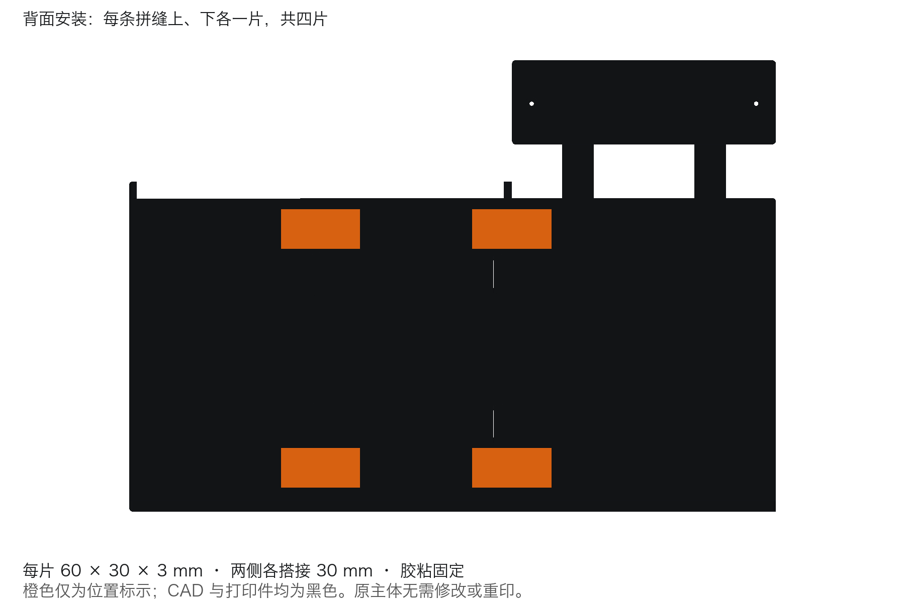
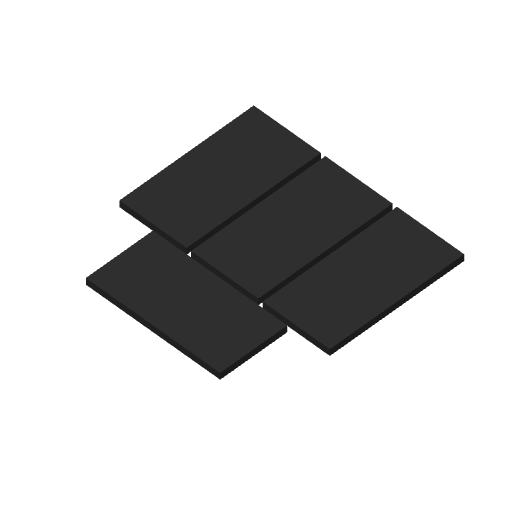

# 四个背面胶粘连接片 · 2026-11-02

[仅连接片3MF](16-reinforcement-plates-only.3mf) · [正式CAD](../../cad/garage-bookshelf-v5-assembly.FCStd) · [CAD检查](native-validation.json) · [兼容性](cad-implementation.json)

Git入库记录：3MF已包含在本地提交`19f4b1b`（`Add four rear reinforcement plates to garage bookshelf v5`）中，仓库路径为`garage-bookshelf/v5/printing/reinforcement-2026-11-02/16-reinforcement-plates-only.3mf`。文件SHA256记录在[交付清单](package-manifest.json)的`project_sha256`字段。

一盘只含四片相同的60 × 30 × 3 mm矩形连接片。车库—左书架、左书架—右书架两处拼缝，各在背面胶粘上、下两片；已有主体不钻孔、不修改、不重印。原有15盘3MF逐个与Git基线核对，字节未变。

片宽中心对准拼缝，两侧各搭接30mm、各有900mm²名义胶粘接触面。下片底边距主体底面18mm（Z=18–48mm）；上片顶边距主体顶面8mm（Z=200–230mm）。胶粘面Y=164mm、外表面Y=167mm；避开燕尾接头和广告牌支架。橙色仅用于示意标记，正式CAD与打印件均为黑色。

先干放核对位置，再清洁粘接面，薄涂适合PLA的胶并压紧，按所用胶的说明固化后再承载。CAD使用名义接触面，没有额外建模胶层厚度。

打印设置：Bambu Lab X2D、0.4mm喷嘴、纹理PEI板、黑色PLA、0.20mm层高、4圈墙、100%之字形填充、无支撑、无擦料塔。四片均以60×30mm大面贴床。估算33.6分钟、26.7g；实际用时和材料以你的打印设置为准。

验证：51个Body有效且各为单实体，370个草图全部约束；原47个Body几何不变；四片无装配体积干涉。四个封闭单实体网格与CAD一致。最终保存3MF已独立重开切片，一盘四对象、无警告、无换料。胶粘效果和承载能力尚待实物验证；不交付G-code。

参数通过正式CAD的`ReinforcementParameters`修改。仅连接片重生成可用FreeCAD自带Python运行`tools/make_reinforcement_project.py --output build/<新运行>/reinforcement-print`。
