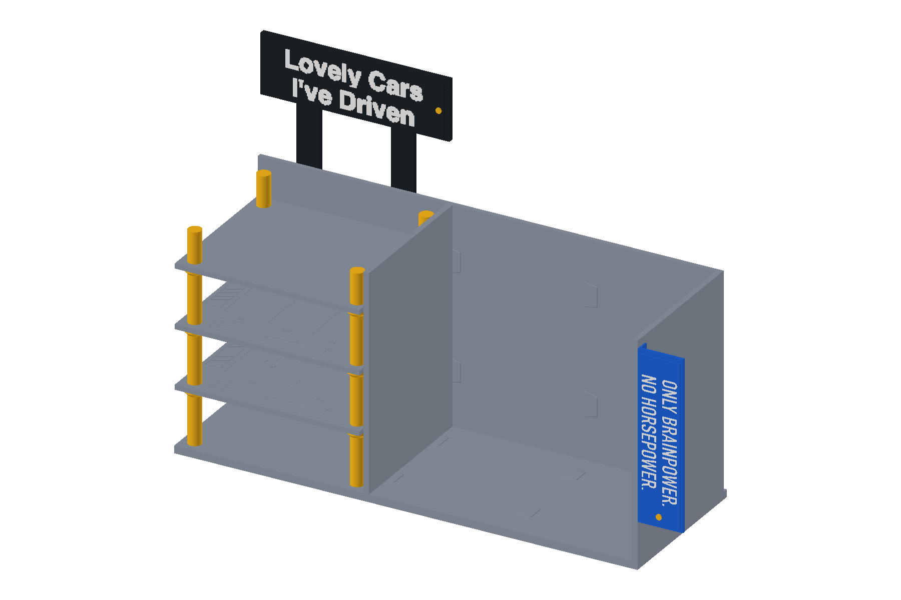
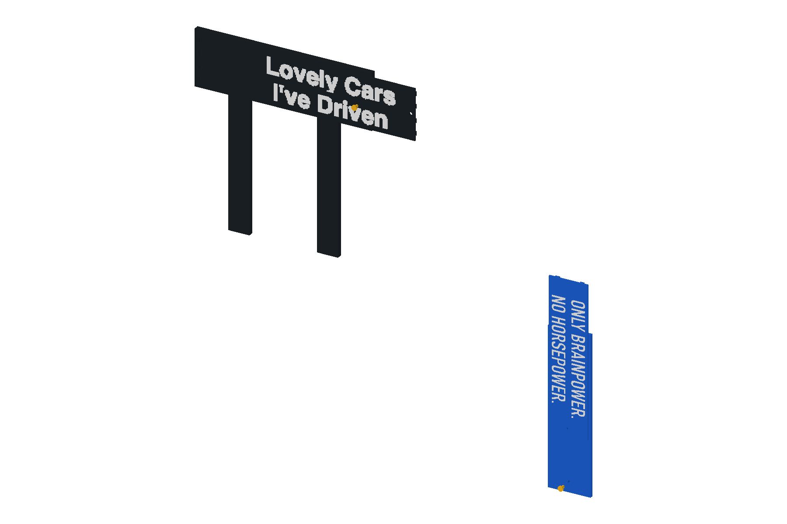
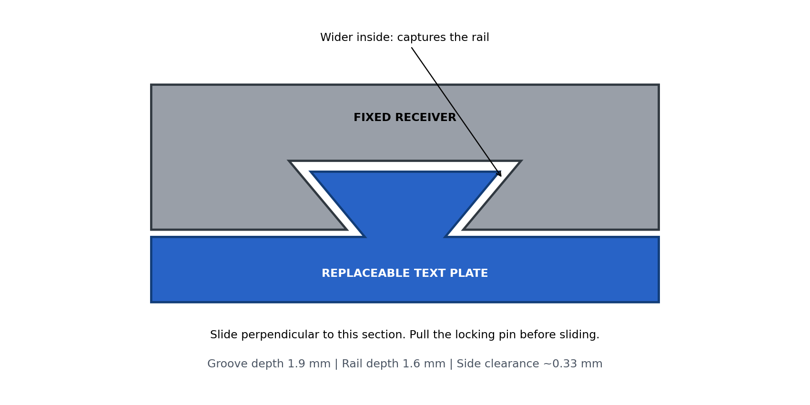

# 可抽换字牌套件 · 49 cm 车库书架

**打印文件已清理（2026-10-23）：** 当前 v4 的 3MF 和打印 ZIP 已删除，待 CAD 定稿后重新生成。正式工程为 `garage-bookshelf-v4-assembly.FCStd`；下文打印清单、切片数据与验证结果保留为历史记录，当前状态见 [PRINT_STATUS.md](../../docs/v4/PRINT_STATUS.md)。

这是缩短后 v4 的正式字牌替换方案。完整装配见 **removable-signs-assembly.FCStd**，保留主体 490 × 170 × 238 mm、书架 290 mm、上方广告牌 200 × 64 mm、右侧牌 48 × 180 mm。原 v4 工程及原打印盘保留作为旧版；本方案请使用本目录工程。右侧字牌及定位销向前增加最多 3.2 mm，总装配包络约 538 × 173.2 × 364 mm。





## 更换文字

- 上方两行合在**同一片 190 × 58 × 1.8 mm 黑色字牌**上，背面四条燕尾轨，整片向右抽换，中间没有分板接缝。固定牌座保留 6 mm 厚，槽从右侧开口，左端封闭。白色字形粘到字牌正面，仅在首次制作这片字牌时粘接；字牌和牌座之间不粘胶。
- 右侧用一片 **44 × 172 × 1.8 mm 蓝色字牌**，背面两条竖轨，从顶部插入，底端封闭。口号在可换字牌正面凹刻 0.6 mm，最薄背厚 1.2 mm，可填白漆。固定牌座加厚至 **4 mm**，母槽深 1.9 mm，槽后保留 2.1 mm 背厚；原一体折边仍与右侧板粘接。
- 每片字牌有一根 **Ø3 mm 定位销**，插入 Ø3.3 mm 孔；销头 Ø6 × 1.2 mm，杆长 5 mm。销跨过字牌进入牌座，防止沿导轨自行滑出。换字时先抓住销头向前拔出，再把上方字牌向右抽出、侧面字牌向上抽出。牌座和支架保持固定。

燕尾截面按参考草图采用**深处宽、开口窄的倒扣形状**，阻止字牌向前脱开。公轨颈宽 2.2 mm、深部宽 5.2 mm；母槽开口宽 3.2 mm、深部宽 6.4 mm。公轨深部进入牌座 1.6 mm，槽深 1.9 mm；实际单侧截面间隙约 0.33–0.35 mm，字牌与牌座正面留 0.2 mm 间隙。没有把负拔模的燕尾做反。

抽换需要上方字牌右侧约 200 mm、侧面字牌上方约 180 mm 的操作空间。上方两行随同一片字牌整体抽出，拔出一根定位销即可更换。定位销为间隙配合，保持可手拔；初次试装时检查销是否容易松脱，尚未进行实物循环插拔验证。

## 打印和装配

先打印 **00-fit-test.3mf** 的 40 mm 母槽及 30 mm 公轨小样，检查能够手动滑入、无明显晃动后再打印大件。不要把试配件当作最终字牌。过紧先处理象脚和毛刺；调整 `DesignParameters` 新增的 Rail/Slot 参数时，公母截面必须同步检查。

| 打印项目 | 颜色 | 内容 |
| --- | --- | --- |
| 00-fit-test | 任意 PLA | 母槽、公轨各一件，小样 |
| 01-top-receiver | 黑 | 上方整块燕尾牌座 ×1 |
| 02-top-carrier | 黑 | 两行一体字牌 ×1 |
| 03-side-receiver | 蓝 | 加厚右侧牌座 ×1 |
| 04-side-cartridge | 蓝 | 可更换凹刻口号字牌 ×1 |
| 05-lock-pins | 黄或其他颜色 | 定位销 ×2 |
| 08-billboard-lettering-white | 白 | 原 08 盘白字，复用已验证项目，打印包已附带 |

STL 已按打印朝向归零：牌座/字牌的大面贴床，燕尾轨朝上，销头贴床。使用 X2D、0.4 mm 喷嘴、PLA、0.20 mm 层高、4 圈墙、25% 填充、4 mm brim；无需支撑。每个保存的项目都独立重开切片，具体结果见 `reports/slicing.json`。压缩包不含 G-code。

本目录套件替代旧版 **07盘中的广告牌**及 **09盘蓝牌**；两根原广告牌支架继续使用。旧 08 盘的两行白字仍可用，把原有字形粘到黑色滑动字牌上：上行文字的全局 X 起点仍为 10 mm、Z 为 332 mm，下行为 X=10 mm、Z=304 mm；整片黑色字牌的 X 起点为 5 mm，下沿为 Z=302 mm；两行文字位置不变。不要把字粘到固定牌座，也不要把字牌或定位销粘死。已经粘在旧广告牌上的白字不保证能无损拆下，必要时用原 08 盘重印文字。

新广告牌沿用原支架的胶接方式；新右侧牌座沿用原 14 × 180 mm 外侧贴合面。若旧牌已经粘牢，换装固定牌座前需先拆下旧牌；本方案不是直接覆盖在旧牌上的附加框。

## 制作其他文字

黑色两行一体滑动字牌本身就是空白载板，可在正面放其他独立字形、贴字或图案；最长可用面为 190 × 58 mm。右侧另提供 **side_cartridge_blank.stl** 无字模板，背部燕尾轨完整保留。复制本目录 FreeCAD 字牌 Body 后替换正面字形草图/Pocket，即可制作多套文字；保留燕尾和定位孔位置，文字不要侵占定位销附近（上方局部 X=185、Z=29；右侧 X=24、Z=12，至少留出销头 Ø6）。

空白侧牌 STL 保留背轨和定位孔；导出自定义字牌时应保留这两处接口。本目录的原生工程包含可编辑的字形、载板、燕尾、定位孔和集中尺寸表。

## 验证与重建

`reports/validation.json` 检查原生实体、草图全约束、整机干涉、抽换路径、倒扣防前脱及定位销阻挡滑动；`reports/fit-test.json` 检查小样；`reports/slicing.json` 记录 6 个新项目的实际重开切片；附带白字项目复用原 08 盘的切片验证，并核对源 STL 与项目哈希（`reports/reused-lettering.json`）。尚未实际打印、试配或做反复插拔寿命测试，几何间隙不是实物配合保证。

```sh
/Applications/FreeCAD.app/Contents/Resources/bin/python build.py
/Applications/FreeCAD.app/Contents/Resources/bin/python coupons.py
/Applications/FreeCAD.app/Contents/Resources/bin/python render.py
python3 make_print_projects.py
```
