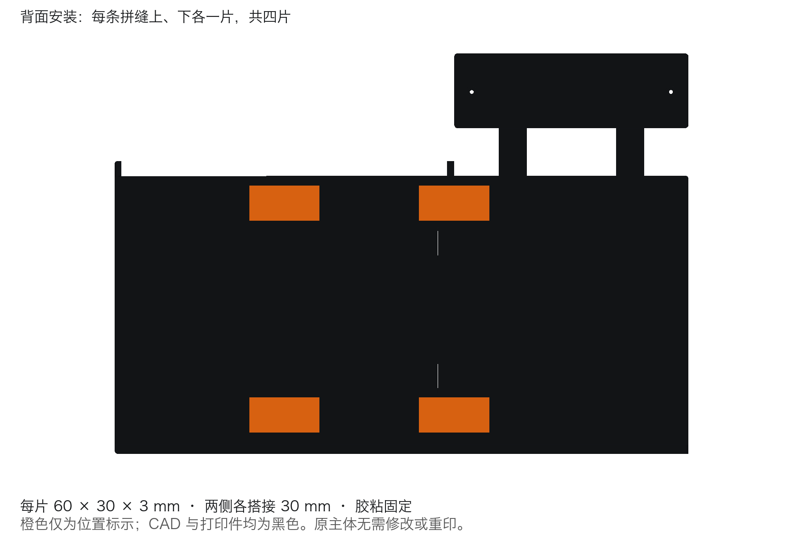

# 组装者指南

先在[打印入口](../printing/README.md)选择主体、两块文字载板及所需车型卡槽。需要定制时看[如何提出定制需求](customization.md)，模型修改由项目维护者协助完成。

## 准备零件

- [主体](../printing/main/README.md)：14盘共40件，包含车库、两半书架、3层停车板、16个柱段、广告牌固定结构、12片三色饰片及4片连接片。
- [文字载板](../printing/sign-carriers/README.md)：上方和右侧各选择一款，共2件。默认款分别对应10盘和12盘。
- 外购4颗M3×8螺钉、4个M3螺母，以及适合所用PLA的胶。
- [车型卡槽](../printing/parking-inserts/README.md)按车辆选配；通用底脚样件没有轮胎固定结构，不能当作已适配车型的卡槽。

每个盘文件按清单打印一次，盘内已经包含相应零件数量。清理支撑、brim和拉丝后，先干装核对，避免粘接后才发现配合问题。当前整机的实物干装、粘接及承载仍待验证。

## 拼装主体

1. 三个主模块从左至右是车库、书架左半、书架右半。接头沿水平方向从右向左滑入（CAD的−X方向），同时对齐底板与背板的配合部位，先确认两条拼缝贴合。
2. 两半书架拼好后干放12片饰片。每色各有背板长片`Back`、底板长片`Floor`、顶沿窄片`TopRim`、前沿窄片`FrontEdge`，按浅蓝、深蓝、红色顺序与模型对应位置对齐。
3. 饰片应落在承托台阶上，与黑色主体表面齐平。确认后只向下沉胶槽放少量胶，保持台阶无胶，再把饰片压到台阶。胶量不用于垫高饰片；饰片不承担主体载荷。尺寸细节供维护者查阅[设计说明](design.md)。
4. 四根柱交替安装：底板定位销 → 4个承托柱段 → 层板1 → 4个承托柱段 → 层板2 → 4个承托柱段 → 层板3 → 4个封顶柱段。三层板由托环承托，销用于定位。
5. 将上方广告牌及其一体支架放到总装模型对应位置，确认背板后方安装面贴合；右侧固定牌座属于主体，保留其载板安装接口。安装位置以[正式总装](../cad/garage-bookshelf-v5-assembly.FCStd)为准。
6. 两条背面拼缝各粘接上、下两片连接片，片宽中心对准拼缝，两侧各搭接30mm。下片底边距主体底面18mm，上片顶边距主体顶面8mm。先干放、清洁，再薄涂胶并压紧，按胶的说明固化后再承载。主体无需为连接片钻孔。

橙色仅用于标示连接片位置，实际打印为黑色。连接片与跨缝饰片粘接后会限制主模块拆分，后续拆装须先处理跨缝粘接件。

## 安装与更换文字载板

上方文字与载板是一体件；右侧口号板装在固定牌座上。用总装中对应的4组M3×8螺钉和螺母安装两块载板，检查贴合后锁紧。更换文字先卸螺钉，只替换对应载板，保留主体安装接口。

上方、右侧的接口不同，选择对应位置的定制款。新文字内容、排版和颜色通过[定制需求说明](customization.md)交给维护者确认。

## 放入车型卡槽

卡槽从上方落入车位浅槽，取放时先抬起，再通过前端取放耳向前移出。每款适用车型及实物试配状态见卡槽选型页；预览图中的车辆或轮胎不等于已完成实车配合验证。

首次使用与维护者一起确认自由落座、手指取放空间、车轮固定和车身净空，记录“卡槽与车位不合适”或“卡槽合适但车辆不合适”，以便定位需要修改的组件。
