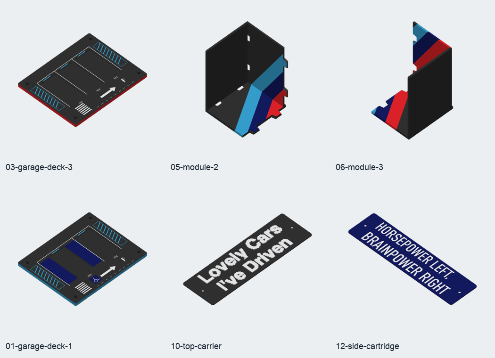

# garage-bookshelf v5 · M Power带色3MF · 2026-10-29

本包替代2026-10-28单色成本预览作为配色打印预览。12盘、26个正式打印件，覆盖黑、白、浅蓝、深蓝、红5个色槽。
**颜色以Bambu Studio可编辑的逐三角面涂色保存在3MF中，并已重开实际切片验证，不是仅把缩略图上色。**

[先看配色预览](color-preview.png) · [全部12盘](plate-overview.png) · [验证记录](color-verification.json)

## 成本

总切片耗材 **3003.3 g（3.003 kg）**，总估算时长 **128小时41分**，软件统计换料次数 **2410**。
按当前擦料塔及自动冲刷设置重新切片计算。用量采用各耗材`total_used_g`之和，已计入切片器统计的多色额外耗材，未另加失败/试件余量。时长为12盘相加，不含人工取件、换盘及停机等待。

| 假设PLA单价（元/kg） | 材料费（元） |
|---|---:|
| 60 | 180.20 |
| 80 | 240.26 |
| 100 | 300.33 |

单价是预算情景，未查询市场报价。材料费＝3.003277 × 实际元/kg。

上次单色基线为1838.7 g、34小时48分、80元/kg时147.10元；本次带色增加1164.6 g、93小时53分，材料费增加93.16元。
主要增量来自两半书架：三色带沿背板高度延伸，需要大量连续换色。此前147元的单色材料费不能作为完整配色成本。

费用不含电费、机器折旧、人工、外购M3螺钉/螺母、失败重打及额外试件。预设中耗材单价仍为19.99/kg，未指定币种；人民币预算按上表单独计算。在Bambu Studio中可把耗材单价改成自己的实际元/kg。

## 逐盘文件

解压后用Bambu Studio打开`3mf/`中的`*-mpower.3mf`，按项目打开，保留其中的打印设置及涂色；不要重新以STL导入。

| 3MF | 内容 | 实际使用颜色 | 耗材 g | 时长 | 材料费：80元/kg |
|---|---|---|---:|---|---:|
| [01-garage-deck-1](3mf/01-garage-deck-1-mpower.3mf) | 停车层板1（2车位） | 黑、白、浅蓝、深蓝 | 134.0 | 4小时14分 | 10.72 |
| [02-garage-deck-2](3mf/02-garage-deck-2-mpower.3mf) | 停车层板2（3车位） | 黑、白、浅蓝、深蓝 | 133.8 | 4小时24分 | 10.71 |
| [03-garage-deck-3](3mf/03-garage-deck-3-mpower.3mf) | 停车层板3（3车位） | 黑、白、浅蓝、红 | 133.4 | 3小时53分 | 10.67 |
| [04-module-1](3mf/04-module-1-mpower.3mf) | 车库主体 | 黑、白、浅蓝、深蓝 | 374.3 | 7小时06分 | 29.94 |
| [05-module-2](3mf/05-module-2-mpower.3mf) | 书架左半 | 黑、浅蓝、深蓝、红 | 940.9 | 52小时16分 | 75.27 |
| [06-module-3](3mf/06-module-3-mpower.3mf) | 书架右半 | 黑、浅蓝、深蓝、红 | 1065.7 | 50小时27分 | 85.25 |
| [07-support-segments](3mf/07-support-segments-mpower.3mf) | 承托柱段 ×12 | 黑 | 89.8 | 2小时27分 | 7.19 |
| [08-top-segments](3mf/08-top-segments-mpower.3mf) | 封顶柱段 ×4 | 黑 | 15.6 | 0小时27分 | 1.25 |
| [09-billboard](3mf/09-billboard-mpower.3mf) | 广告牌与竖杆 | 黑、浅蓝、红 | 56.0 | 1小时20分 | 4.48 |
| [10-top-carrier](3mf/10-top-carrier-mpower.3mf) | 顶部可换字牌 | 黑、白 | 22.6 | 0小时51分 | 1.80 |
| [11-side-receiver](3mf/11-side-receiver-mpower.3mf) | 右侧固定牌座 | 黑 | 24.7 | 0小时35分 | 1.98 |
| [12-side-cartridge](3mf/12-side-cartridge-mpower.3mf) | 右侧可换口号板 | 白、深蓝 | 12.5 | 0小时41分 | 1.00 |
| 合计 | 26件 / 12盘 | 全套5色 | 3003.3 | 128小时41分 | 240.26 |

## 色槽

全套5色，每盘最多用4色；打印前按当前盘的颜色把项目色槽映射到实际装载的耗材。仅黑色的柱段、封顶段和固定牌座保持黑色。

| 槽 | 颜色 | 目标HEX | 切片总耗材 g |
|---|---|---|---:|
| 1 | 黑 | `#16181B` | 1954.9 |
| 2 | 白 | `#F4F5F6` | 19.6 |
| 3 | 浅蓝 | `#39A9DB` | 312.6 |
| 4 | 深蓝 | `#151B65` | 435.5 |
| 5 | 红 | `#ED242A` | 280.7 |

槽底的更深黑外观与主体共用黑色耗材；没有额外增加一卷近黑耗材。

## 已保留的配色

- 三块层板自下而上的浅蓝、深蓝、红色边缘；白色停车线、编号、箭头及斑马线，浅蓝安全线和深蓝区域。
- 书架背板、底板、顶沿及前沿的浅蓝/深蓝/红等宽三色带，延续CAD中的分布和接头处衔接。
- 广告牌支架正面的浅蓝和红；该面打印时朝向热床，普通俯视缩略图看到的支架背面仍是黑色。
- 黑底白字的顶部字牌；深蓝底白字的右侧口号板。

## 设置和验证

X2D、0.4 mm标准喷嘴、PLA、纹理PEI板，0.20 mm层高、4圈墙、25% grid填充、4 mm自动brim。第05/06盘开启仅接触热床的自动支撑；启用擦料塔，冲刷矩阵由Bambu Studio按色槽生成。

- 12盘保存后独立重新加载，未额外覆盖配置，全部实际切片通过；切片器使用的耗材槽与文件内涂色槽一致，无模型切片警告。
- 26件的三角网格分别与已验证的单色3MF比较，完全一致；只改了颜色、耗材及多色所需的打印设置和排盘。正式CAD未修改。
- 三色带按0.20 mm自适应分辨率映射到Bambu三角涂色树，未把零厚度外观面添加成打印实体。三种颜色映射面积与CAD色面总面积的差异均小于0.002%，详见`color-verification.json`。
- 10项单元/工作流检查通过，包括色带穿过大三角形、三种颜色分别保留和面积守恒检查。
- 外购硬件、托座样件及未完成的车型轮胎夹不包含在26件内。
- 本包是可编辑的带色成本预览，尚未实物试配，计划仍为draft；不交付打印G-code，不作为正式生产发行。

`manifest.json`记录项目设置、网格签名、涂色槽、实际切片耗材及输出哈希。`source-geometry-manifest.json`和`source-cad-validation.json`记录几何来源；本包不重复附STEP/STL。`cost-estimate.json`保存预算与包内校验值。

## 重新生成

使用FreeCAD自带Python运行`tools/make_colored_projects.py --export-dir <当前几何导出目录> --single-color-dir <配套完整单色打印结果目录> --output build/<新的空目录>`。源CAD、人工项目和冻结预设均不会被覆盖。
涂色编码参考[Bambu Studio TriangleSelector](https://github.com/bambulab/BambuStudio/blob/master/src/libslic3r/TriangleSelector.cpp)和[FacetsAnnotation](https://github.com/bambulab/BambuStudio/blob/master/src/libslic3r/Model.cpp)的序列化格式。
