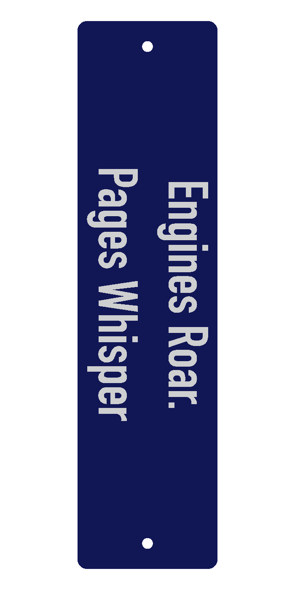
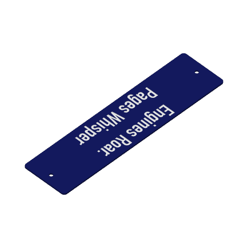

# 右侧竖牌 · Engines Roar. Pages Whisper

[3MF打印项目](engines-roar-pages-whisper.3mf) · [可编辑CAD](../../../../cad/sign-carriers/side/engines-roar-pages-whisper/engines-roar-pages-whisper.FCStd) · [验证记录](validation.json)

文字分为“Engines Roar.”和“Pages Whisper”两列，保留原句大小写和标点。深蓝底白字，文字凹刻0.4mm，与此位置的原款保持一致。接口`sign-side-v1`，一件直接替换对应位置的原文字载板，保留主体、牌座和M3紧固件。

项目耗材序号为2白色、4深蓝色；请按实际装料映射到打印机料槽。

一盘一个对象。X2D、0.4mm喷嘴、纹理PEI、PLA、0.20mm层高、4圈墙、25%填充、无支撑；带双色配色和擦料塔。先按实际装料核对耗材槽位再切片。估算37分钟、13.2g，以实际切片为准。

已通过原生参数往返、背面接口差体积为0、M3孔位和R3圆角继承、装配净空、封闭单连通网格、保存后几何与颜色保留，以及独立重开3MF切片检查。未完成实物试装，不交付G-code。

[组装与更换](../../../../docs/assembly.md) · [文字载板规范](../../../../docs/interfaces/sign-carriers.md)
