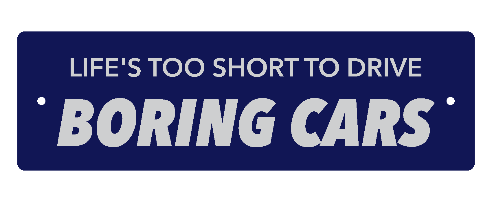
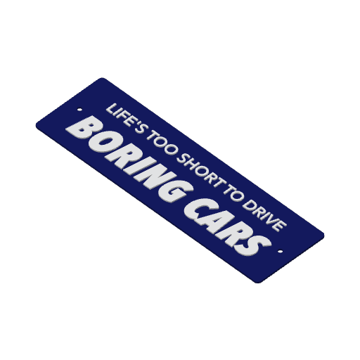

# 上方横牌 · LIFE'S TOO SHORT TO DRIVE BORING CARS · r2

[双色3MF打印项目](lifes-too-short.3mf) · [可编辑CAD](../../../../cad/sign-carriers/upper/lifes-too-short/lifes-too-short.FCStd) · [验证与哈希](validation.json)

上行`LIFE'S TOO SHORT TO DRIVE`采用8mm的Avenir Next Demi Bold，下行`BORING CARS`采用20.5mm的Avenir Next Condensed Heavy Italic。全大写、小标题配大号粗斜体，两行居中。深蓝底`#151B65`、白字`#F4F5F6`，凸起1mm，整体190×58×2.4mm。接口`sign-upper-v1`，替换上方同位置载板，沿用M3紧固件。

项目耗材序号2白色、4深蓝色，请按实际装料映射到打印机料槽。一盘一个对象；X2D、0.4mm喷嘴、纹理PEI、PLA、0.20mm层高、4圈墙、25%填充、无支撑，双色配色及擦料塔已保存。独立重开切片估算约44分钟、22.0g，以实际切片为准。

原生保存后重开重算、两行字高随参数往返、全约束草图、单实体、背面接口差体积为0、M3孔位与R3圆角继承、装配净空、封闭单连通网格、CAD与3MF尺寸和配色，以及独立重开3MF切片均通过。本次改色保留原生几何内容和打印网格，几何验证沿用同一几何的r2记录；配色与独立重开切片本次重新执行，时间及几何比较见`appearance_update`。模型警告与CLI工具消息分别记录于`validation.json`及原始日志。实物打印与试装尚未完成，不含G-code。

原始CLI日志、冻结打印配置、检查STL及生成器快照保存于`evidence/`；`validation.json`的`artifact_locations`逐项关联实际文件。r1的原始CAD、文字和打印件保存在[旧版归档](../../../../archive/printing/2026-11-04-lifes-too-short-r1/README.md)。

[组装与更换](../../../../docs/assembly.md) · [文字载板规范](../../../../docs/interfaces/sign-carriers.md)
