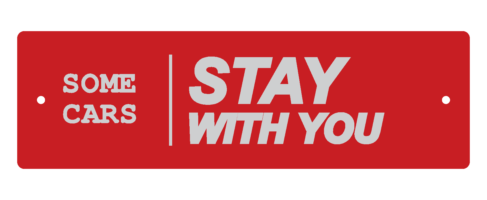
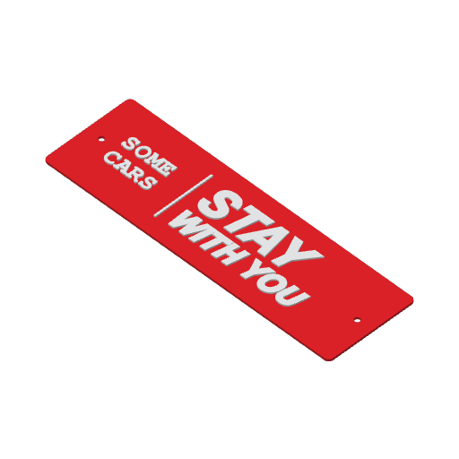

# 上方横牌 · Some Cars Stay with You

[双色 3MF](some-cars-stay-with-you.3mf) · [可编辑 CAD](../../../../cad/sign-carriers/upper/some-cars-stay-with-you/some-cars-stay-with-you.FCStd) · [验证记录](validation.json)

红底白字，约 1:2 分栏，以白色竖线分隔。左栏 SOME / CARS 采用加字距的 Courier New Bold，右栏 STAY / WITH YOU 采用加粗的 Arial Bold Italic，凸字 1 mm。载板 190 × 58 × 2.4 mm，沿用 `sign-upper-v1` 牌座和 M3 紧固件。

Bambu Lab X2D、0.4 mm 喷嘴、PLA、0.20 mm 层高。文件耗材序号 2 为白色、5 为红色。重开 3MF 切片通过，估算 48 分钟、21.4 g。实物试装待验证。

