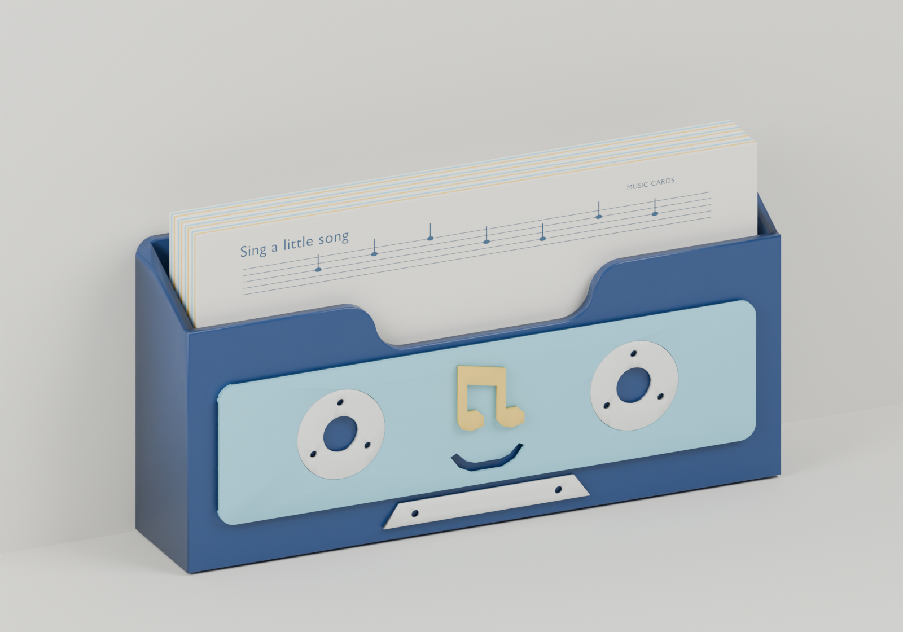

# music-card-box

挂在墙上的笑脸磁带卡片盒：深蓝主体、浅蓝面板、白色卷带眼睛、黄色音符。用于横放音乐卡片，从顶部抽取。

| 组件 | 职责 | CAD / 打印入口 |
|---|---|---|
| 主体 | 承托卡片、取卡凹口、后侧垫筋、平整贴墙背板 | [主体 CAD](cad/main/README.md) · [主体打印](printing/main/README.md) |
| 磁带装饰 | 面板、卷带眼睛、下部磁头饰片、音符；分别打印后粘贴 | [装饰 CAD](cad/decorations/README.md) · [装饰打印](printing/decorations/README.md) |

## 使用资料

1. [设计与尺寸](docs/design.md)：卡片适配、取放方式、外形与配色。
2. [打印入口](printing/README.md)和[组装上墙](docs/assembly.md)：选择文件、粘贴装饰与安装。
3. [验证状态](PROJECT_STATUS.md)：数字验证范围、实物待办。

## 维护资料

[维护与复现](docs/maintenance.md) · [CAD 说明](cad/README.md) · [设计变更](CHANGELOG.md)

目录职责沿用 [garage-bookshelf v5 规约](../garage-bookshelf/README.md#版本目录规约从v5开始)，本项目根目录直接作为当前设计入口，不额外套用 `v5/`。组件目录按本产品改为 `main/`、`decorations/`，不建立无关的广告牌与车位卡槽目录。

| 路径 | 职责 |
|---|---|
| `cad/` | 当前正式原生总装、STEP、模型规范与组件索引 |
| `src/music_card_box/` | 可复用建模、验证与导出逻辑 |
| `tools/` | 生成、渲染、整理交付和校验命令 |
| `tests/` | 交付完整性与 3MF 网格检查 |
| `assets/` | 固定输入：尺寸配色与用户照片 |
| `docs/` | 设计、组装、维护与共用接口规范 |
| `printing/` | 当前分色打印文件、预览、清单和原始验证证据 |
| `studies/` | 独立试验、配合试件及实物反馈 |
| `build/` | 按运行名保存的可再生成候选结果；不纳入 Git |
| `archive/` | 被替换的正式版本和旧证据；不作为当前打印入口 |

此页维护阅读路线和资料职责，具体文件、尺寸和验证结论由相应索引与说明维护。
