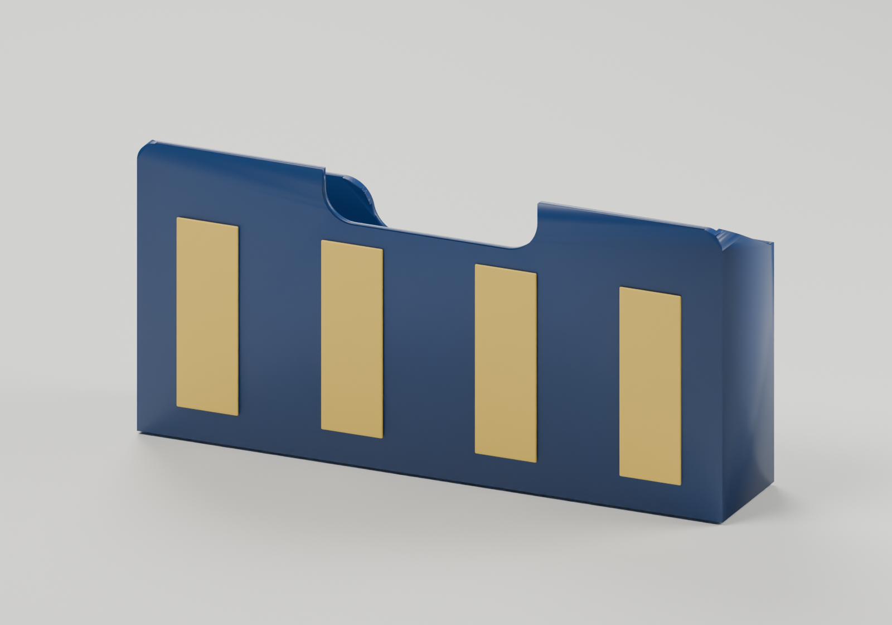

# 打印、组装与上墙

先从[打印入口](../printing/README.md)取得主体和装饰文件，确认[验证状态](../PROJECT_STATUS.md)。

2026-11-06 当前主体和白色项目保留后续保存的自动 brim（宽度 5 mm）、2 道墙、3 层底部等设置，并已重新切片。主体位置也已平移；跨项目合盘需重新排盘。[当前保存记录](../printing/saved-projects-20261106.json)优先说明实际文件状态，以下强制外侧扩边与工艺建议同时保留作初始参考。

## 打印

共六个实体打印件：一个主体、一个浅蓝面板、两只相同卷带轮、一片白色磁头饰片、一枚黄色双音符。不需要多色打印机；每个颜色分别打印后粘贴即可。

- **主体必须保持文件内的直立姿态，盒底贴热床、开口朝上。不要把背板放平打印，否则前壁会跨越大面积内腔。** 主体包络 190.4 × 38.4 × 92 mm；外侧 5 mm brim 已写入主体 3MF。
- 装饰件已将实际粘贴背面放平到 Z=0，颜色分别成组。白色文件包含两只卷带轮和一片磁头饰片，数量已齐。
- 起始工艺建议：0.4 mm 喷嘴、0.20 mm 层高、4 道墙、5 层顶底、15% 填充，PLA。主体按无支撑方向设计；具体支撑、温度、流量与 brim 以所用机器和材料的切片预览为准。
- 饰片厚度 1.4–1.8 mm，注意薄片首层与小音符的粘床。去掉 brim 和毛刺，特别检查取卡口、底部内角与垫筋顶端。

四个分色 3MF 均已保存 X2D / 标准 0.4 mm / PLA / 纹理 PEI 设置，并通过重开和切片检查；在 Bambu Studio 中以新项目打开。装饰新版统一错开各色占位，避免把多个旧文件合到一盘时走线重叠；如使用多个装饰文件，请同时换用新版 02 / 03 / 04。更换机器、喷嘴或材料时需重新选取对应设置，核对外侧 brim 仍为 5 mm 后切片。所有件均尚未实机确认。

## 装饰与卡片试放

1. 先干装：将浅蓝面板贴在盒体正面，下面留出白色磁头饰片位置；面板中央顶边低于取卡凹口 2 mm。
2. 两个卷带轮放入面板的圆孔，孔内露出深蓝主体。面板与卷带轮都直接粘到盒体，轮子不旋转。
3. 白色梯形磁头饰片粘在面板下方；黄色音符粘到面板中央。对照[空盒效果图](../printing/main/r1/empty.png)。
4. 使用适合所用打印材料的胶，薄涂并避免进入轮孔、笑脸或卡槽；模型为这些粘接面留了约 0.2 mm 胶层。按胶的说明完成固化。
5. 上墙前在桌上试放实际卡片，检查整摞顺畅上下取出、单张不会刮伤。如实际厚度超过 25 mm，先调整设计，不要硬塞。

## 用 3M 胶上墙

背面四条黄色区域为可用贴胶区示意，不是另需打印的黄色件。坐标和边界见[共用接口规范](interfaces/mounting.md)。

1. 称量“盒子 + 整摞卡片”的实际总重，再按墙面材质、涂层和该重量选用合适的 3M 胶产品；遵守所选产品的承重、清洁、按压、等待和拆除说明。未指定型号，本文不假定统一承重或等待时长。
2. 修整打印背面凸点，确保胶面能贴平。先核对墙面适用性和选定位置；卡片上方留出至少 115 mm，避免抽取受阻。
3. 参考四个 20 × 60 mm 区域分布贴胶，具体胶条数量、裁切与间距服从所选产品要求。如采用带拉伸移除尾端的产品，保留尾端可抓取空间，勿把尾端封在盒后。
4. 空盒按产品说明粘贴并等待，随后逐步装入卡片，观察是否翘起或滑移。取卡时向上提，避免持续向外掰盒子。

背面可用面积已做 CAD 检查，墙面粘接和载荷仍需实测；首轮实物结果记入 `studies/`，注明胶的准确型号、墙面、总重量及观察时长。
