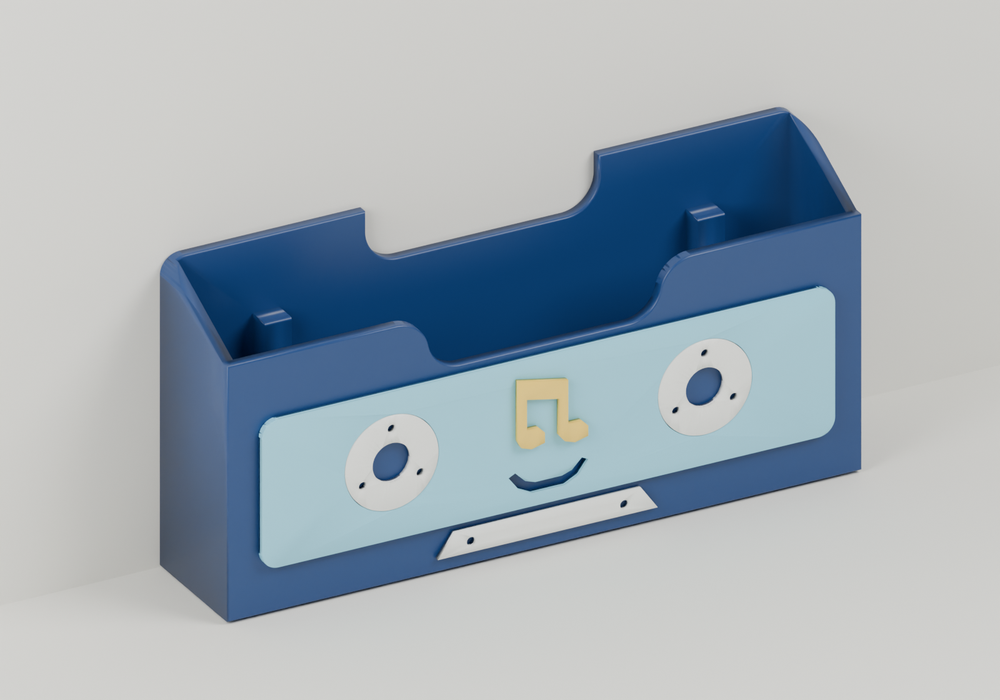
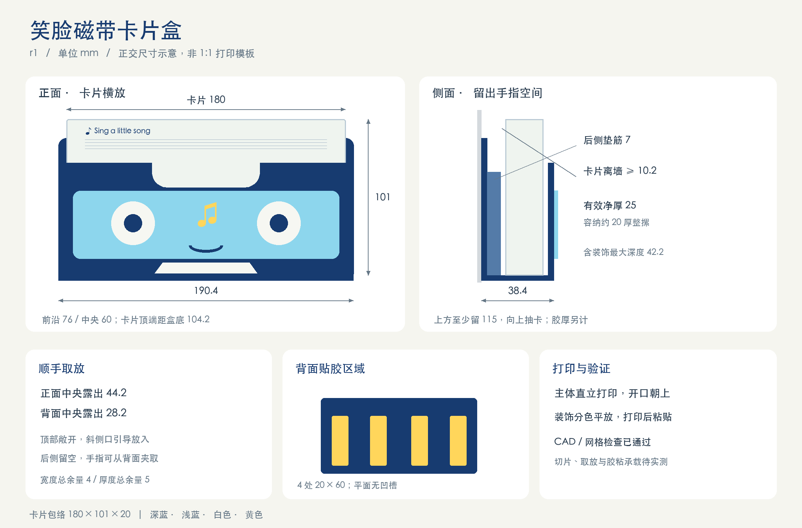

# 设计：笑脸磁带盒

卡片保持照片中的横向使用方式。盒子像一盘带有表情的磁带：两只白色卷带轮兼作眼睛，面板开出的微笑透出深蓝底色，中央黄色双音符进一步强调音乐主题。装饰采用实体分件，不依赖涂色效果图。

## 尺寸

单位均为 mm；尺寸输入冻结于 [design.json](../assets/design.json)。

| 项目 | r1 尺寸 / 关系 |
|---|---|
| 卡片 | 180 宽 × 101 高；整摞约 20 厚 |
| 有效收纳净宽 × 净厚 | 184 × 25；宽度每侧约 2，厚度总余量 5 |
| 实际槽深 | 32，其中后侧垫筋占 7；卡片位于垫筋前方 |
| 主体宽 × 深 × 高 | 190.4 × 38.4 × 92 |
| 含装饰最大离墙深度 | 42.2，另加实际墙面胶厚度 |
| 壁厚 / 底厚 | 3.2 / 3.2 |
| 前沿两侧高度 / 中央凹口底 | 76 / 60 |
| 背板两翼高度 / 中央凹口底 | 92 / 76 |
| 前后取卡凹口宽度 | 70，底部转角半径 10 |
| 卡片顶部高度 | 距盒底 104.2 |
| 中央抓取露出高度 | 正面 44.2、背面 28.2 |
| 卡片与墙的最小距离 | 10.2，另加实际墙面胶厚度 |
| 装饰定位间隙 | 卷带轮径向 0.2，即直径方向 0.4 |
| 装饰胶层预留 | 0.2，靠粘贴固定，无卡扣 |

## 取放

顶部完全敞开，两侧边缘从后部向前部降低。两条垫筋将卡片向前移，让背面凹口处留有手指空间；正面低凹口方便拇指抓住整摞或分取卡片。建议手指夹住卡片上部，向上取出。盒子上方至少预留 115 mm 的抽卡行程。

数字检查覆盖 180 × 101 × 20 mm 刚性矩形卡片包络，在有效厚度范围内的前、中、后位置及多档提升高度。此检查验证直线取出不碰模型，不代替真实手指手感或软卡片散开的实物检查。

## 上墙

背面 Y=0 为平面，无螺丝头、浮雕或贴胶凹槽。四处参考贴胶区均为 20 × 60，合计 4800 mm²。这只是可用几何面积，不是胶带承重认证。上墙步骤、胶带选择和待验证事项见[组装说明](assembly.md)。

## 配色与组件

| 颜色 | 零件 | 设计意图 |
|---|---|---|
| 深蓝 `#173B70` | 盒体 | 深色轮廓、微笑和卷带轮孔的底色 |
| 浅蓝 `#8DD6ED` | 面板 | 柔和、轻快的磁带主色 |
| 白色 `#F6F7F2` | 两只卷带轮、下部磁头饰片 | 形成可爱的眼睛与磁带识别特征 |
| 黄色 `#FFD65B` | 双音符 | 视觉焦点 |

主体独立承重；装饰件不参与卡片支撑或墙面固定。所有颜色均在用户给定色系内。
