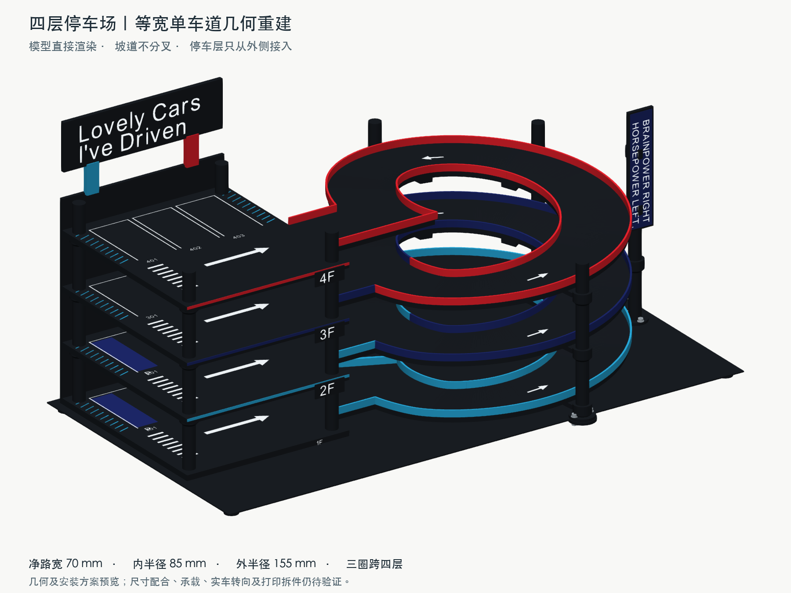
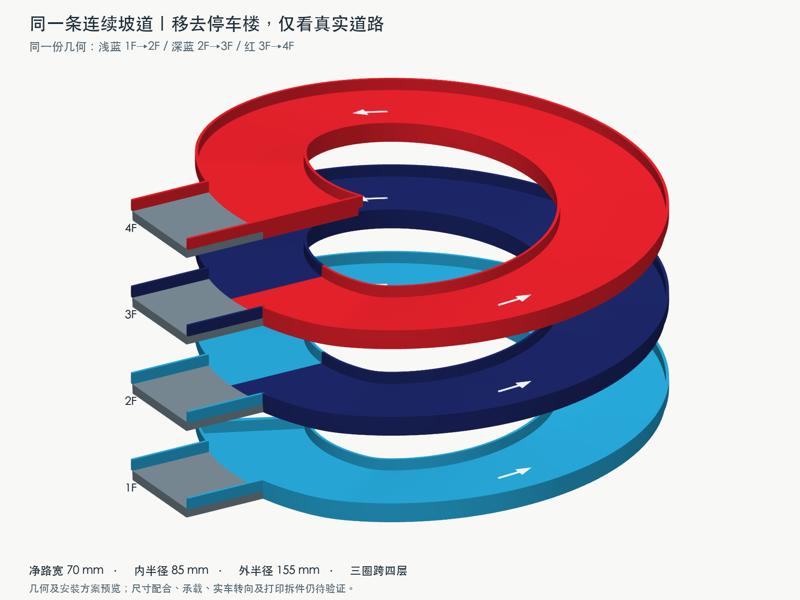

# 四层停车场 · 概念 01

**当前版本：2026-11-02 等宽单车道、4F 收口与原车库分段柱复用方案。** 沿用 garage-bookshelf v5 的 garage 造型、四层停车区、黑色与三色收边、顶部广告牌及侧面口号牌。

旧的 07/08 两张图存在入口变窄、道路分叉和宽度失真的问题，已否决。当前预览全部从同一份显式三维网格直接渲染，尺寸与连接以本页当前几何为准。



已去掉 4F 接入口之后带挡墙的多余死端，收口与顶层接入通道前缘齐平。当前黑色支撑直接复用原车库 CAD 的标准柱段、封顶段与销孔接口，详见[分段柱复用说明](concepts/01-side-helix/geometry-rebuild/installation/column-reuse/README.md)。

[4F 修改细节](concepts/01-side-helix/geometry-rebuild/installation/12-4f-terminal-detail.png) · [复用柱与托臂分解](concepts/01-side-helix/geometry-rebuild/installation/column-reuse/17-column-reuse-exploded.png) · [三根柱的复用范围](concepts/01-side-helix/geometry-rebuild/installation/column-reuse/18-column-reuse-layout.png) · [托环／销孔半剖](concepts/01-side-helix/geometry-rebuild/installation/column-reuse/19-column-tab-section.png)。

## 道路怎样连接

主坡道是一条等宽的单车道螺旋带，三圈连续上升，依次经过 1F、2F、3F、4F。坡道净宽始终为 **70 mm**，内侧护栏内边界半径 85 mm，外侧护栏内边界半径 155 mm。

每层只在坡道外侧开一个侧向接口，以 **70 mm 等宽短通道** 接入停车区。主坡道不拆成上下两条路，也不增加下坡捷径。车辆在同一条主坡道上分时上下行；在 2F/3F 接点可转入停车区，也可沿主坡道继续绕行。

连接口位于每圈同一角度的水平段内。连接通道的弧形末端与坡道外缘逐点对齐，接缝两边同高。护栏在侧接口处断开，其余部分位于 70 mm 净路面之外。



上图只隐藏停车楼与支撑，并将三段道路表面分别着色以便追踪；道路的几何、宽度与整体图相同。1F 端部保留挡墙，4F 则在接入通道前缘直接收口，不保留外伸死端。侧接口保持开放。

[俯视净宽校核图](concepts/01-side-helix/geometry-rebuild/11-geometry-width-plan.png)同时标注入口和弯道路宽。该图显示车道边界的平面投影，省略端部挡墙；上下层投影重合，不表示道路在同一高度。

## 当前概念尺寸

| 项目 | 当前几何 |
|---|---|
| 停车区平面 | 200 × 230 mm |
| 停车位 | 2／2／3／3，共 10 位 |
| 四个停车面高度 | 8、71、134、197 mm |
| 主坡道净宽 | 全程 70 mm |
| 四层接入通道净宽 | 各 70 mm，含 1F 出入口 |
| 主坡道内／外净半径 | 85／155 mm |
| 路板厚度 | 6.6 mm |
| 护栏 | 净路面之外另加 2 mm 厚、8 mm 高 |
| 每层接点的水平范围 | 接点前后各 25°；升坡两端各 15° 坡度缓变 |
| 最大纵坡 | 中心线约 10.2%；内缘约 14.4% |
| 路板之间竖向间距 | 路面至上层路板底为 56.4 mm |
| 含安装托臂、螺钉头的最小局部净空 | 约 47.9 mm，详见检查记录 |
| 概念整体包络 | 含柱脚局部底座、脚垫和广告牌约 635 × 366.8 × 325 mm |

坡道外侧三根 Ø14 柱每根采用一个定高底段、两个原标准柱段和一个原封顶段。托臂根部做成 6.6 mm 带孔安装片，按「下段托环 → 安装片 → 上段柱」叠装，原 Ø6 销穿片后插入上段盲孔。56.4 mm 柱段＋6.6 mm 安装片正好匹配 63 mm 层距。侧广告牌柱同样复用原柱段，三个接口加同厚垫片；坡道与侧牌共复用 9 个标准段、4 个封顶段。

轨道由下方 M3 螺钉接入底侧热熔嵌件，定高底段的法兰以螺栓固定。车库四柱也采用复制的原柱实体。立柱和托臂根部安装片位于净路面以外，托梁和螺钉头在路板下方。车位线、编号、斑马线、浅蓝斜线和深蓝停车装饰由几何生成；道路没有暗示双车道的分隔线。

当前是几何与安装方案样模，已检查等宽、接缝、网格闭合、柱段与托臂的配合；实际试装、承载、实车转向及打印拆件尚未完成。叠装柱与托臂后需安装轨道分片，分片接头仍待设计。局部安装 CAD 已示意制造孔，连续主道路网格仍不是打印交付。前一轮两半抱箍方案保留在[安装历史说明](concepts/01-side-helix/geometry-rebuild/installation/README.md)，已被当前分段柱方案替代。

## 几何检查与复现

[geometry-checks.json](concepts/01-side-helix/geometry-rebuild/geometry-checks.json)记录：

- 全部采样截面的路宽为 70 mm，浮点误差小于 0.000001 mm。
- 四个接入通道均为 70 mm，接缝高差为 0。
- 主道路与四条接入通道合并网格的开放边及非流形边数为 0。
- 道路网格只有 1 个连通分量，四个接口属于同一个连续实体。
- 含路板下方托梁的局部净空单独计算，不以板间净空代替。
- 4F 外伸死端已裁掉，终点 Y=40；新增安装零件的螺钉头计入净空。

在 parking-lot 目录运行：

```sh
/Applications/FreeCAD.app/Contents/Resources/bin/python concepts/01-side-helix/geometry-rebuild/build_geometry.py
```

本轮使用本地几何生成与 VTK 渲染，不读取或修补旧效果图。以下文件均在 parking-lot 内，未修改 garage-bookshelf。

| 文件 | 用途 |
|---|---|
| [09-geometry-overall.png](concepts/01-side-helix/geometry-rebuild/09-geometry-overall.png) | 当前整体预览 |
| [10-geometry-road-only.png](concepts/01-side-helix/geometry-rebuild/10-geometry-road-only.png) | 同一模型的坡道剥离预览 |
| [11-geometry-width-plan.png](concepts/01-side-helix/geometry-rebuild/11-geometry-width-plan.png) | 入口、弯道净宽的俯视校核 |
| [build_geometry.py](concepts/01-side-helix/geometry-rebuild/build_geometry.py) | 同一份三维几何与三张图的生成入口 |
| [constant-width-road.vtp](concepts/01-side-helix/geometry-rebuild/constant-width-road.vtp) | 主道路及四条接入通道的封闭网格，单位 mm；非打印文件 |
| [geometry-checks.json](concepts/01-side-helix/geometry-rebuild/geometry-checks.json) | 尺寸、接缝、网格与净空检查结果 |

## 历史参考

以下图像仅保留造型探索和过程记录，不作为当前道路几何依据。07/08 已因物理连接错误作废。

| 文件 | 记录 |
|---|---|
| [01 初版效果图](concepts/01-side-helix/01-parking-lot-concept.png) | 黑色主体、广告牌及装饰参考 |
| [02 早期通行示意](concepts/01-side-helix/02-route-diagram.png) / [SVG](concepts/01-side-helix/02-route-diagram.svg) | 早期比例和中心线探索；尺寸已被当前模型替代 |
| [03 正面](concepts/01-side-helix/03-front-view.png) | 初版多视角 |
| [04 坡道侧斜视](concepts/01-side-helix/04-ramp-side-view.png) | 初版多视角 |
| [05 背面](concepts/01-side-helix/05-rear-three-quarter-view.png) | 初版多视角 |
| [06 连接原理](concepts/01-side-helix/06-ramp-connections.png) / [SVG](concepts/01-side-helix/06-ramp-connections.svg) | 解释各圈共享接点的拓扑关系；不作为当前尺寸图 |
| [07 已否决整体图](concepts/01-side-helix/07-2f-up-down-connections.png) | 入口宽度及分叉错误 |
| [08 已否决局部图](concepts/01-side-helix/08-2f-landing-closeup.png) | 同上 |

历史图像使用内置 image_gen 生成／编辑。[主图提示词](concepts/01-side-helix/generation-prompts.md) · [初次接入口修正](concepts/01-side-helix/correction-prompt.md) · [多视角提示词](concepts/01-side-helix/multi-view-prompts.md) · [已否决修图提示词](concepts/01-side-helix/connection-render-prompts.md)。
