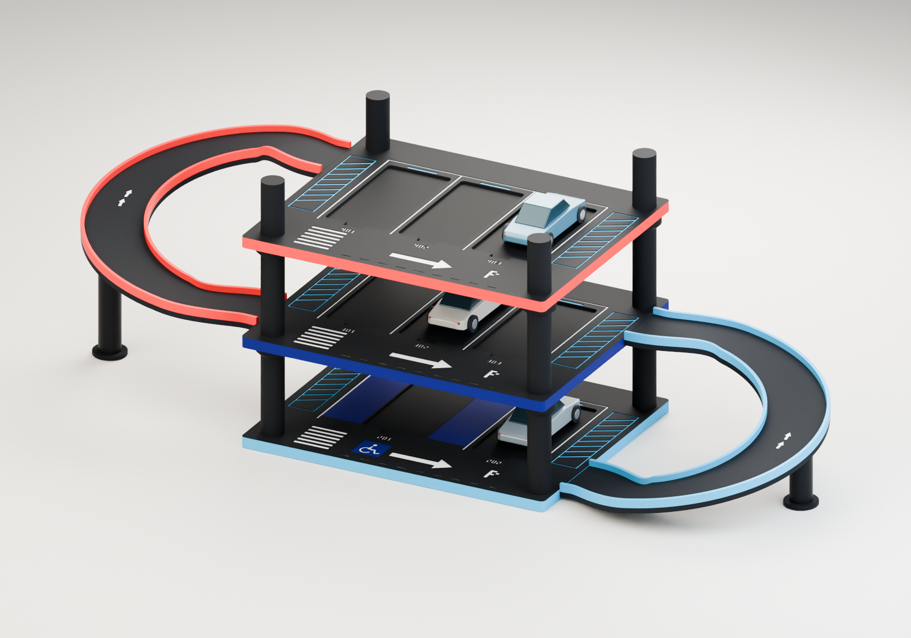

# Parking Lot · 三层交替半旋坡道

当前设计直接复用 Garage Bookshelf v5 的三块停车层板和黑色圆柱。右侧浅蓝坡道从一层右前升至二层右后，穿过二层后，再从二层左前走红色坡道升至三层左后。

[多角度效果图与动线说明](concepts/02-alternating-half-turn/README.md)

[三层车库 CAD v2](v2/README.md)

[已停用的四层方案](concepts/01-side-helix/README.md)
