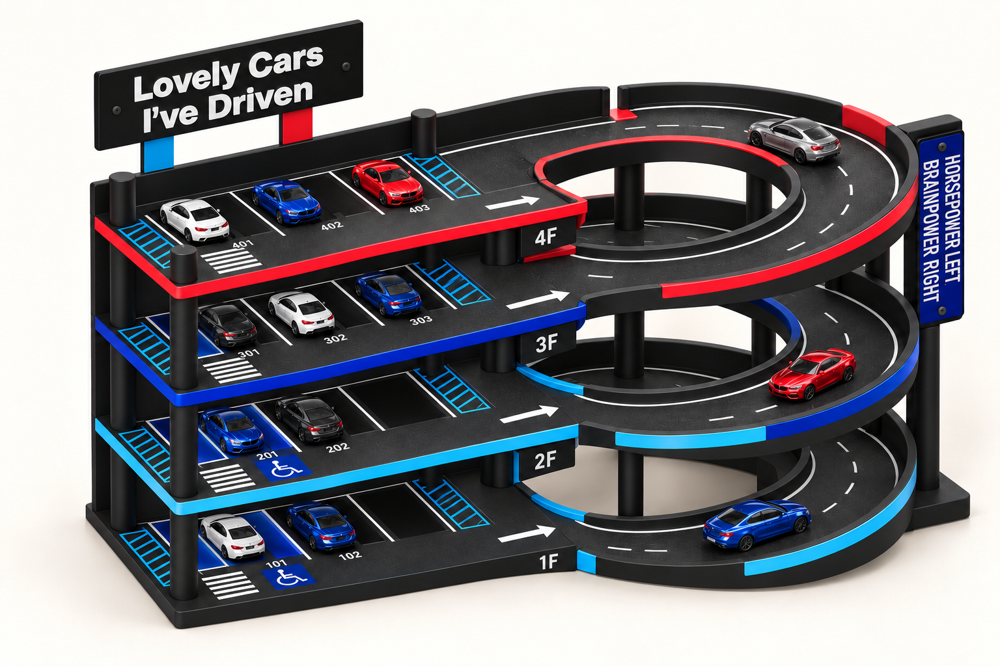
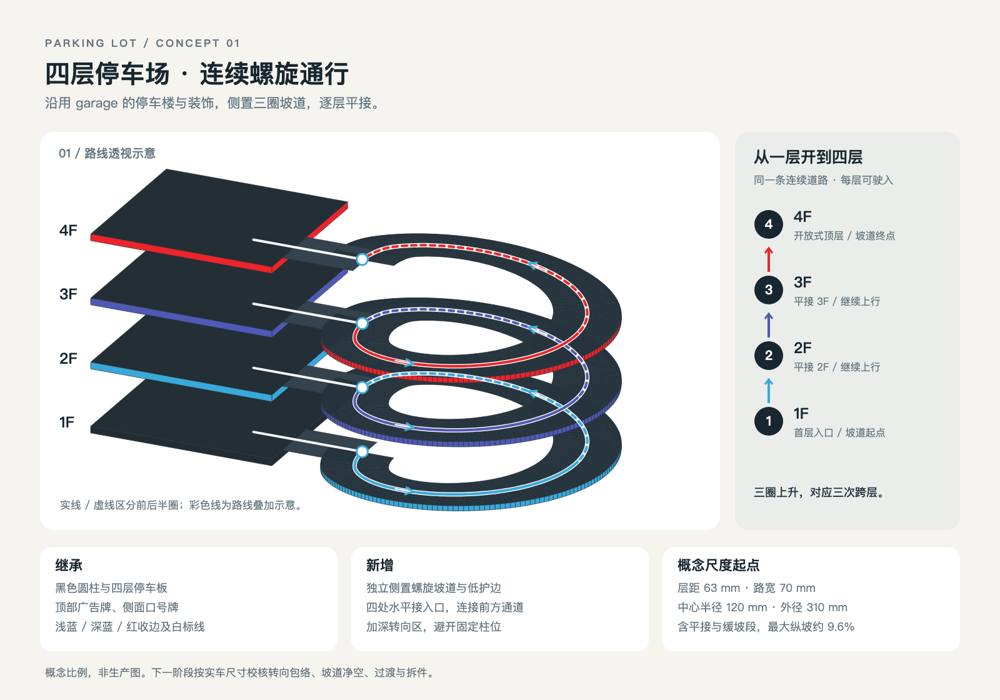

# 四层停车场 · 概念 01

2026-11-01。沿用 garage-bookshelf 最新 v5 的 garage 设计语言，形成独立四层停车场，原书架一侧改为连续螺旋道路。本阶段交付概念图和通行逻辑，不含生产 CAD 或打印文件。

## 方案

左侧为开放式停车楼，右侧为侧置螺旋坡道，共用底座。首层加三个悬空停车层构成四层，顶层露天，不再增加第五层或顶盖。三圈连续上升的道路依次连接 **1F → 2F → 3F → 4F**；四处接入口位于同一侧，以水平平台衔接每层前方通道。单车道供车模分时上下行。

保留黑色主体、圆柱、背板和浅蓝／深蓝／红层板收边；保留白色车位线、编号、箭头、斑马线、浅蓝禁停斜线及深蓝无障碍装饰。车位安排延续 **2／2／3／3，共 10 位**，编号 101–102、201–202、301–303、401–403。

顶部广告牌延续黑底白字 **Lovely Cars / I've Driven**，左浅蓝、右红支架。深蓝色螺钉口号牌 **HORSEPOWER LEFT, / BRAINPOWER RIGHT** 移至坡道外侧支撑位置。

旋转道路采用黑色路面、低护边和随高度变化的三色点缀。入口处护边开口，柱位避开通行面。原 garage 的前方通道用于场景装饰，本方案将停车板加深，为转向与坡道接入留出空间。停车位内的展示结构不进入通行道路。

## 通行逻辑

[查看可缩放 SVG](concepts/01-side-helix/02-route-diagram.svg)。该图由参数化矢量脚本生成，用于明确道路关系；立柱、广告牌、车辆和装饰以效果图为造型参考。

| 项目 | 概念起点 |
|---|---|
| 停车楼宽度 | 约 200 mm，沿用原 garage 名义宽度 |
| 停车楼深度 | 约 220 mm，原版约 159 mm；增加前方转向空间 |
| 四个停车面高度 | 8、71、134、197 mm |
| 层距 | 63 mm |
| 坡道净路宽 | 约 70 mm |
| 坡道中心半径 | 约 120 mm |
| 内／外半径 | 85／155 mm，路面外径约 310 mm，护边另计 |
| 坡道圈数／总爬升 | 三圈／189 mm |
| 每圈平接与过渡 | 接入口两侧各 15° 水平段，升坡两端各 15° 坡度缓变 |
| 中心线最大概念纵坡 | 约 9.55%；63 ÷ (120 × 315° 的弧度值) |
| 平面占地估计 | 约 550 × 310 mm，护边与外挂牌另计 |
| 车模比例参考 | 长约 85、宽约 38 mm，仅用于构图与初步路宽 |

路线脚本已检查中心线单调上升、三圈首尾连续以及四层标高对应。以上为概念参数；效果图不承诺尺寸精度。后续 CAD 需要按实际车模核对转向包络、坡道护边净宽、路板厚度、跨层净空、平坡过渡、支撑和拆件连接。

## 文件与生成记录

所有本次工作文件均位于本目录。原 garage-bookshelf 文件未修改。

| 文件 | 内容 |
|---|---|
| [01-parking-lot-concept.png](concepts/01-side-helix/01-parking-lot-concept.png) | 1536 × 1024 主概念效果图，已修正层间入口和下两层车位 |
| [02-route-diagram.png](concepts/01-side-helix/02-route-diagram.png) | 1600 × 1120 通行说明图 |
| [02-route-diagram.svg](concepts/01-side-helix/02-route-diagram.svg) | 可缩放通行图源文件 |
| [draw-route.py](concepts/01-side-helix/draw-route.py) | 通行图生成脚本及中心线连续性检查 |
| [generation-prompts.md](concepts/01-side-helix/generation-prompts.md) | 主概念图完整提示词 |
| [correction-prompt.md](concepts/01-side-helix/correction-prompt.md) | 接入口、柱位及车位修正的完整提示词 |
| [drafts/01-initial-render.png](concepts/01-side-helix/drafts/01-initial-render.png) | 初稿，保留供追溯，以修正版为准 |
| [references/](concepts/01-side-helix/references/) | 原 v5 装配效果图及四层标线参考图的副本 |

主效果图使用**内置 image_gen** 生成并编辑，未使用 CLI/API 回退。通行图使用本地 SVG 绘图并由 Chrome 渲染为 PNG，不是 AI 生成的结构验证结果。
