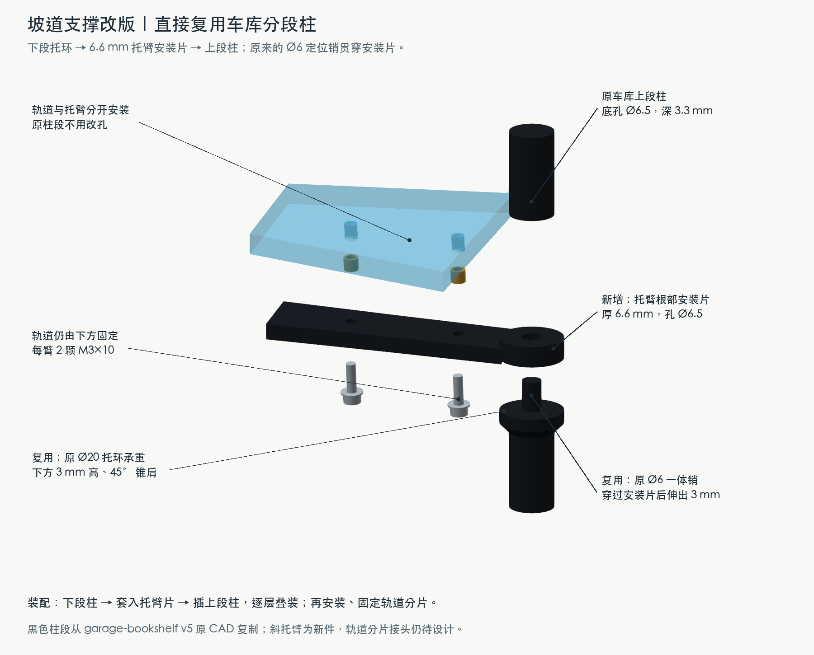
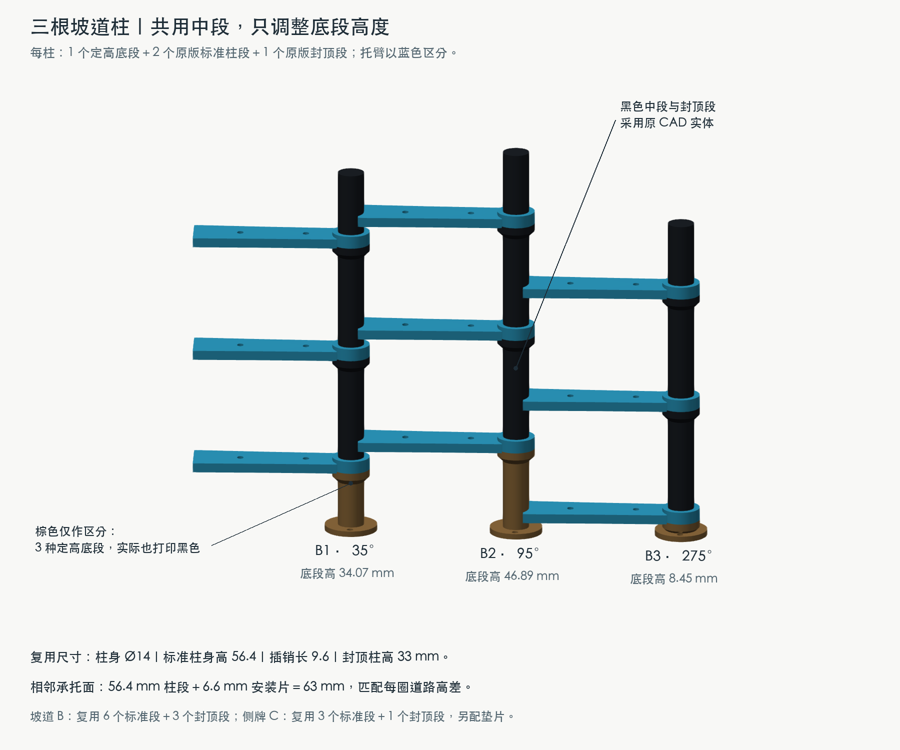
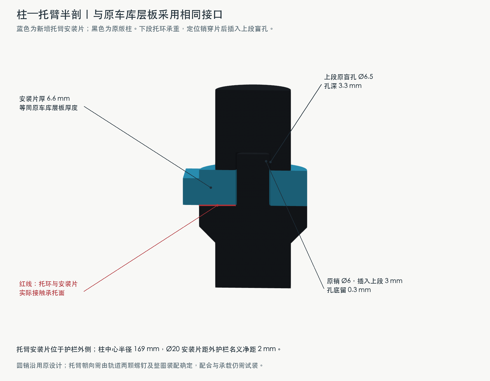

# 复用 garage-bookshelf 分段支撑柱

2026-11-02。当前支撑方案。直接从 garage-bookshelf v5 CAD 读取并复制标准柱段与封顶段，不修改原工程。新件为坡道托臂、三种定高底段，以及侧牌柱的底部转接座和垫片。



## 为什么能直接复用

原车库的标准柱身高 **56.4 mm**，原层板厚 **6.6 mm**，组合后正好是本停车场的 **63 mm** 层距。坡道在同一平面位置每绕一圈也上升 63 mm，因此可把托臂根部做成与层板等厚的安装片，夹在上下两段原柱之间。

原接口全保留：柱身 Ø14、承托环 Ø20 × 4、下面 3 mm 高的 45° 锥肩、Ø6 × 9.6 一体定位销、Ø6.5 × 3.3 柱底盲孔。托臂安装片厚 6.6、穿孔 Ø6.5，销穿过后仍有 3 mm 进入上段，孔底余量 0.3 mm。

这是对原实体的复用：标准段与封顶段分别复制自 `column_1_segment_1_Body`、`column_1_segment_4_Body`。标准段含销总高为 66 mm；本页的 56.4 mm 指承托柱身高度，不含销。封顶段高 33 mm。几何快照、来源文件哈希和体积记录保存在 [reference/source.json](reference/source.json)，生成器只读本目录快照，不依赖原项目之后的修改。

## B · 三根坡道柱



每根为：**1 个定高底段 → 托臂 → 原标准段 → 托臂 → 原标准段 → 托臂 → 原封顶段**。托臂安装片由下段的托环承托，上段柱底压在安装片上。九只托臂的斜梁上表面跟随道路局部坡度。

同一根柱的三个安装片间距均为 63 mm。B1/B2/B3 所在角度不同，首圈路面高度不同，所以仅底段分别定高；原标准段、原封顶段不加长、不改孔。

| 柱 | 平面角度 | 首圈路面 Z | 新底段柱身高 | 三处承托环顶面 Z |
|---|---:|---:|---:|---|
| B1 | 35° | 46.975 | 34.075 | 35.375 / 98.375 / 161.375 |
| B2 | 95° | 59.788 | 46.888 | 48.188 / 111.188 / 174.188 |
| B3 | 275° | 21.347 | 8.447 | 9.747 / 72.747 / 135.747 |

单位 mm。底段柱身高从底座上表面 Z=1.3 算至托环顶面，不含插销；含一体底法兰。18 图中的棕色底段、蓝色托臂用于区别零件，实际都可以打印黑色。

安装片中心位于半径 169 mm、外径 20 mm，内缘到外护栏外缘半径 157 mm 的名义净距为 2 mm。安装片不占用 70 mm 净路面。梁仍位于道路下方，由两颗 M3×10 和垫片从下方拧入轨道底侧短热熔嵌件，固定方式见上一方案的轨道侧剖面；夹柱的两半抱箍和横向夹紧螺钉已取消。

## 接口半剖



红线为实际承托面。竖向载荷传至原托环和柱身，圆销负责定位。圆销不提供独立的角向锁定；托臂朝向由轨道上的两颗固定螺钉和三根柱的整圈装配位置确定。最终转动间隙、整体刚度与承载需实物验证。

## A / C 与复用数量

| 位置 | 原标准柱段 | 原封顶段 | 新增件 |
|---|---:|---:|---|
| A · 车库四柱 | 12 | 4 | 当前停车板和底板接口 |
| B · 坡道三柱 | 6 | 3 | 三种定高底段、9 只斜托臂 |
| C · 侧广告牌柱 | 3 | 1 | 短底部转接座、3 个厚 6.6 的带孔垫片 |

坡道和侧牌新增的柱件共可复用 **9 个原标准段、4 个原封顶段**。C 柱由垫片补足原层板的厚度，柱顶到 Z=230；牌框仍按当前整体图布置。底部螺栓连接沿用两颗 M3×10、上下垫片与底面螺母，详见 [16 图的左侧底法兰示意](../16-base-and-garage-installation.png)。

## 装配边界

1. 安装带底法兰的定高底段，暂不完全锁紧柱脚。
2. 在原 Ø6 销上套入托臂安装片，再插入原标准柱段；逐层重复，最后插封顶段。侧牌柱的三个接口用同厚垫片替代托臂片。
3. 将预装底侧热熔嵌件的轨道分片放到托臂上，由下方逐步固定；校正三柱与道路位置后锁紧柱脚。

**此方案要求轨道分片装配。** 当前连续道路网格用于检验通行几何；道路的打印切分、分片接头和各分片安装次序尚未设计，不能将整条连续螺旋带硬套进已装好的柱与托臂。这里交付的是复用接口和支撑装配样模，不是整机打印交付。

## 验证与文件

- 三种定高底段、全部原柱段及托臂均为有效 BRep 实体。
- 九处托臂与柱的体积重叠为 0，到托环承托面的距离为 0；所有柱段两两无体积穿插。
- 含托臂及螺钉头的主坡道局部最小净空为约 47.9 mm；70 mm 道宽、四处接点零高差与封闭道路网格检查仍通过。
- 标称销孔间隙沿用原车库，尚未做实物试装、热熔工艺、承载或车辆转向验证。

[column-reuse-study.FCStd](column-reuse-study.FCStd) / [column-reuse-study.step](column-reuse-study.step) 包含 B3 柱、三层托臂、局部轨道和螺钉的 36 个实体；局部轨道有真实孔，但不代表已完成连续主道路的制造孔系。

[column-reuse-checks.json](column-reuse-checks.json) 为本方案检查记录；[../../geometry-checks.json](../../geometry-checks.json) 为整机道路记录。

生成源文件：[column_parts.py](column_parts.py)、[draw_column_reuse.py](draw_column_reuse.py)。在仓库根目录运行：

```sh
PYTHONDONTWRITEBYTECODE=1 /Applications/FreeCAD.app/Contents/Resources/bin/python parking-lot/concepts/01-side-helix/geometry-rebuild/build_geometry.py
PYTHONDONTWRITEBYTECODE=1 /Applications/FreeCAD.app/Contents/Resources/bin/python parking-lot/concepts/01-side-helix/geometry-rebuild/installation/column-reuse/draw_column_reuse.py
```

[extract_references.py](extract_references.py) 仅用于主动更新原柱实体快照；常规重绘不需要执行。它只读原 FreeCAD 文档，写入本目录。
