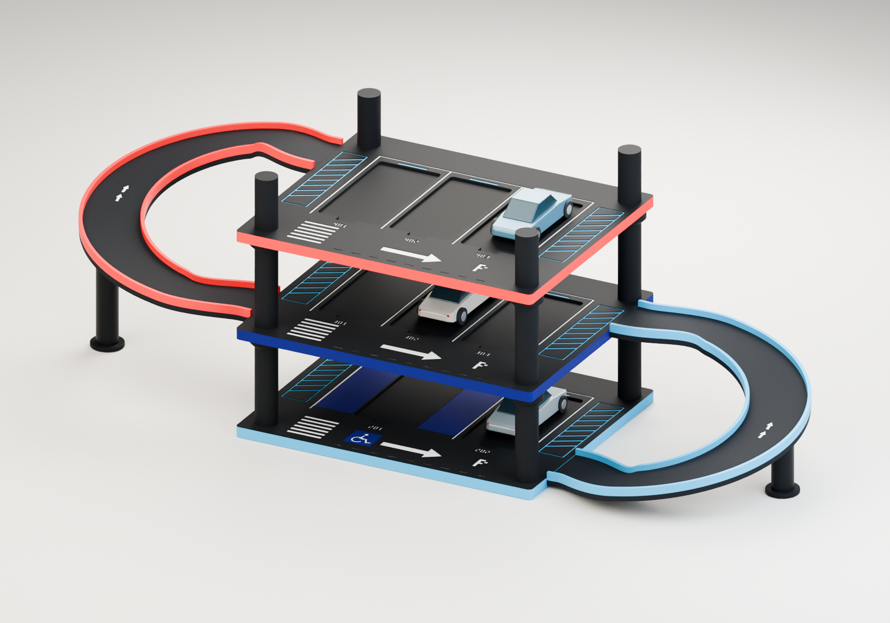

# 三层车库 · 交替半旋坡道

2026-11-08。三块停车平台上下对齐，三层为露天停车面。左右与前后均以车库正面为基准。

| 路段 | 起点 | 终点 |
|---|---|---|
| 右侧浅蓝色半旋坡道 | 一层右前 | 二层右后 |
| 二层横向通道 | 二层右后 | 二层左前 |
| 左侧红色半旋坡道 | 二层左前 | 三层左后 |

两侧各用一段外凸半圆坡道升一层。坡道两端接平楼面，过渡段将开口收向板边，避开原车库四角的圆柱。

三张楼面分别取自 Garage Bookshelf v5 的 `garage_deck_1`、`garage_deck_2`、`garage_deck_3`。每块为 **195.6 × 158.6 × 6.6 mm**，楼面间距为 **63 mm**。效果图读取原件表面与配色，包括车位凹槽、编号、箭头、斑马线、安全斜线和无障碍标记。三层板边依次为浅蓝、深蓝、红。四角采用原版黑色圆柱、托环和柱帽。[Garage Bookshelf v5 总装来源](../../../garage-bookshelf/v5/cad/README.md)

- 右侧浅蓝坡道接入一层右前和二层右后。[右前斜视](original-parts/01-front-right.png)
- 左侧红坡道接入二层左前和三层左后。[左后斜视](original-parts/02-rear-left.png)
- 顶层的车位凹槽和地面图案。[高位斜俯视](original-parts/03-high-front.png)
- 三层板边和原版圆柱的比例。[正面视角](original-parts/04-front.png)

效果图从总装读取停车层板与圆柱的表面网格和逐面颜色。四个角度共用同一个 Blender 渲染场景。
