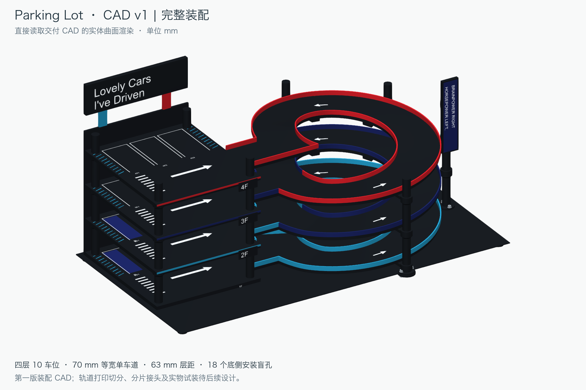

# Parking Lot · CAD v1

2026-11-02。依据 [当前 concept](../README.md) 制作的第一版完整装配 CAD，单位 **mm**。

- **打开主文件：[parking-lot-v1-assembly.FCStd](cad/parking-lot-v1-assembly.FCStd)**
- **通用交换文件：[parking-lot-v1-assembly.step](cad/parking-lot-v1-assembly.step)**，包含零件名称和颜色。
- [完整装配预览](reports/assembly-preview.png) · [道路预览](reports/road-preview.png) · [背面预览](reports/rear-preview.png)
- [验证记录](reports/validation.json) · [零件清单](reports/parts.json) · [构建和来源记录](reports/build.json)



## 本版包含

四层停车楼，车位为 **2／2／3／3，共 10 个**；停车区平面 200 × 230，路面高度为 8、71、134、197。主坡道为三圈连续的共享单车道，净宽 70，内外净半径为 85／155，路板厚 6.6，层距 63。四条 70 宽接入通道与水平接点同高，4F 在 Y=40 直接收口。护栏位于净路面之外，厚 2、高 8。

包括底座与脚垫、四层平台、后背板、原车库四柱、三根坡道支撑柱、九只托臂、侧牌支撑柱、三色收边、顶部广告牌、侧面口号牌、车位标线与编号。九只托臂各配两处底侧安装盲孔，共 **18 个 Ø4 × 5 孔**。M3 螺钉、垫片、螺母及热熔嵌件为无螺纹的安装外形示意。

原车库柱段直接复制已有 BRep 快照：A 区 12 个标准段＋4 个封顶段，坡道及侧牌 9 个标准段＋4 个封顶段，共 **29 个原柱实体**。不修改 garage-bookshelf 项目或 concept 文件。

## 从概念到工程实体的处理

1. 主道路重新构建为光滑 BRep 曲面实体。三个升坡段使用原生 `Part::Loft` 和全约束截面草图；水平接点及接入通道使用精确圆弧。整条道路布尔合并后为一个连续实体，包含实际安装盲孔。
2. 一楼抬高平台与薄底板合并为一个底座实体，消除概念图中的体积重叠。二至四楼使用原生 `PartDesign::Body`、草图、Pad 和 Pocket，可在 FreeCAD 中展开编辑。
3. 背板由概念中的 Y=229…233 调整为 Y=230…234，放到完整停车平台外侧；广告牌支柱落在背板上，并与牌板下缘衔接。
4. 托臂根部安装片仍为 6.6 厚，直接落在原托环上；梁面与道路底面之间留 **0.05 装配余量**，由底侧螺钉收紧。这样避免两份独立放样曲面恰好相切时的不稳定交集。垫片和螺钉位置随梁面调整。
5. 侧牌框在背面避让柱身及托环，蓝色面板前移至 Y=63…64，避免原托环穿过面板。板框和面板为独立实体。
6. 车位线、文字和箭头均为有厚度的 CAD 实体，未使用贴图。白色车位线厚 0.12，主要文字厚 0.2，属于装配外观表达；后续打印可再转换为嵌件或凹槽。

## 如何编辑

主文件可独立打开，不需要运行 Python，也不依赖概念网格。装配树按停车楼、道路、护栏、原车库柱、坡道支撑、装饰、紧固件和文字分组；放样截面集中在默认隐藏的 `90 · 道路放样截面` 分组。

`DesignParameters` 表驱动道路截面尺寸及层板 Pad/Pocket 的部分表达式。**这不是任意修改尺寸后全机自动适配的参数化装配**：圆弧接点、支撑柱、托臂、安装孔和标识由生成器计算；要整体修改，请先修改 [parameters.json](parameters.json)，再运行 [build.py](build.py) 并重新验证。63 层距依赖 56.4 柱身＋6.6 安装片的既有接口，改变它需要同时重设计支撑接口。

原柱实体及定制支撑保留为独立 BRep 特征。它们在主文件中可移动、测量和继续添加特征，原柱历史草图不在本项目中重建。

## 检查与复现

当前交付包含 219 个显示对象；道路截面及层板草图共 381 个，全部全约束。检查脚本重新打开主文件，检查闭合实体、四处同高接缝、曲面采样、九处柱／托臂配合、含紧固件的局部净空，以及安装孔上方保留的路板材料。STEP 重新导入后逐个核对实体数量及体积，详细数值见 [validation.json](reports/validation.json)。

在仓库根目录运行，使用本机已安装的 FreeCAD Python：

```sh
/Applications/FreeCAD.app/Contents/Resources/bin/python parking-lot/v1/build.py
/Applications/FreeCAD.app/Contents/Resources/bin/freecad parking-lot/v1/Review.FCMacro
/Applications/FreeCAD.app/Contents/Resources/bin/python parking-lot/v1/validate.py
/Applications/FreeCAD.app/Contents/Resources/bin/python parking-lot/v1/render.py
```

GUI 宏为主文件保存颜色、可见性和相机，并导出带颜色的 STEP。预览图由重新打开的交付 CAD 实体直接渲染。生成器只读 concept 内的支撑辅助代码及柱段 BRep 快照，依赖文件哈希记录在 `reports/build.json`。

## 版本边界

**本版是装配设计 CAD，不是整机打印交付。** 连续道路及大底板尚未进行打印切分，轨道分片接头、分片安装顺序、背板和广告牌的可拆连接仍需后续细化；本版不得把整条连续螺旋带视为能套入已组装柱架的单件。小字号标识、标线的实际打印方式也待确定。

销孔、热熔嵌件、螺钉长度及 0.05 托梁余量尚未进行实物试装；承载、整体刚度与模型车转向尚未验证。CAD 检查通过表示所列几何检查通过，不替代这些实物验证。
