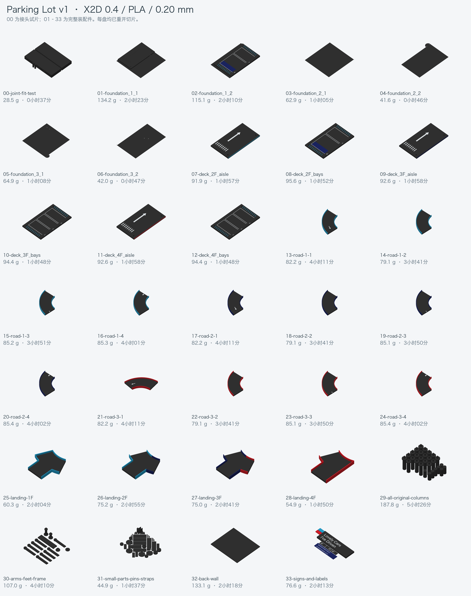

# Parking Lot v1 · X2D 3MF 打印包

2026-11-03。完整新打印一套停车场的首轮原型包：**33 盘装配件，另加 1 盘接头试片，共 34 个 3MF**。装配件 142 个，试片件 4 个；螺钉、螺母、垫片、嵌件均不作为塑料打印件。

完整装配件预计 **2832.1 g、92 小时 08 分**；包含试片后合计 **2860.7 g、92 小时 45 分**。统计已计入切片器估算的支撑和换色擦料，明细按颜色及盘号分别列出。

- [下载完整打印包](parking-lot-v1-X2D-3mf.zip)
- [34 个 3MF 文件](3mf/) · [排盘总览](plate-overview.png)
- **[打印用料与耗时汇总](打印用料与耗时.md)** · [逐盘 CSV](print-estimates.csv) · [机器可读统计](summary.json)
- [装配说明](装配说明.md) · [俯视定位图](assembly-plan.svg)
- [打印拆件 CAD](parking-lot-v1-print-parts.FCStd) · [实体连接验证](geometry-validation.json)



## 打印设置

沿用已有车库项目的 **Bambu Lab X2D、双 0.4 mm 标准喷嘴、纹理 PEI 板、PLA、0.20 mm 层高、4 圈墙、25% 填充**。定位销、连接片、小件盘及接头试片采用 100% 填充。坡道及 30 号盘启用仅热床支撑；有多色的盘启用擦料塔。各盘的具体参数已保存在 3MF 中。

颜色为黑、白、浅蓝、深蓝、红。每个文件只保留本盘使用的颜色，打开后按颜色映射 AMS 耗材；不同盘的本地耗材序号可能不同。四只脚垫也按硬质黑色 PLA 计入；若改用软材料，需要另配材料参数并重切片。

估算按全新打印全部零件计算，包括 21 个标准柱段和 8 个封顶段。已有足量相同柱件时可跳过 **29 号盘**，不可把它误解为跳过 29 盘。

**建议先打印 00 接头试片，再试打一段坡道。** 验证双销能插合、接缝能齐平、支撑可清理后再展开整套打印。本包完成了数字模型及切片验证，尚未实物打印和承载验证。

## 从装配 CAD 到打印件

原 [v1 装配 CAD](../cad/parking-lot-v1-assembly.FCStd) 保留原文件及哈希；本包的制造细化在独立的打印拆件 CAD 内：

1. 三圈升坡各拆 4 段，共 12 段，另有 4 个水平接入口。每个升坡段约 77.5°，保持路板厚 6.6、63 层距和 70 净路宽。
2. 护栏位于净路面外侧。原装配示意仅与路板边线接触，本包将彩色护栏下延至路板底面，使其通过完整的 6.6 mm 高侧面与路板相连。道路整体外宽相应为 74 mm，**净行车宽仍为 70 mm**。接入口不同颜色的护栏角部已去除体积重叠。
3. 六块底座面板保持原外形；底座下四个圆垫分开打印，使大面板能平贴热床。七块 60 × 20 × 1.5 胶粘连接片在底部跨缝固定。
4. 二至四楼各拆为过道半片和停车位半片，分界为 Y=110。四层平台接缝及道路接缝均设双定位销孔：**孔 Ø3.3、每侧深 5.2；销 Ø3 × 10**。共有 19 处双销接缝，使用 38 根装配销；00 盘另带 2 根试片销。
5. 标线和文字改为彩色实体嵌件，埋入 0.4、凸出 0.2，不单独打印薄字片。它们与所在打印件以多材料体保存，同时写入 Bambu 实际配色数据。
6. 牌板正面朝上平放打印。楼层标签贴合面已补齐，底层编号已贴合底座正面。另加广告牌背面连接条与背板底部胶粘角撑；本版采用定位销＋胶粘装配。

## 验证范围

所有网格均闭合且无非流形边。独立重新打开打印拆件 CAD，将每个机械打印件的各颜色合并，要求得到 **一个有效闭合实体**，并检查颜色体积不重复计算。这会检查每个字点、斑马线和护栏是否实际接在主体上。

每个最终 3MF 都使用其保存的设置独立重开切片；检查一文件一盘、对象数量、材料分配、热床范围和模型切片警告。打包时还逐件对照原导出网格与最终 3MF 的几何。最终结果、哈希及真实切片估算见 `summary.json`、`results/`。

不交付打印机 G-code，也不自动发送打印任务。请在 Bambu Studio 打开 3MF，核对你的机器、耗材与热床后重切片。估算包含切片器计入的支撑与换色擦料，不包含人工换盘、冷却取件、修整、胶固化及装配时间。

## 复现

在仓库根目录运行：

```sh
/Applications/FreeCAD.app/Contents/Resources/bin/python parking-lot/v1/printing/build_print_parts.py
/Applications/FreeCAD.app/Contents/Resources/bin/python parking-lot/v1/printing/validate_parts.py
/Applications/FreeCAD.app/Contents/Resources/bin/python parking-lot/v1/printing/make_projects.py --resume
/Applications/FreeCAD.app/Contents/Resources/bin/python parking-lot/v1/printing/package.py
```

`make_projects.py --only <盘ID>` 可只生成指定盘；`--resume` 只复用文件哈希与输入网格哈希都相符的已通过切片项目。机器和耗材参数的完整副本包含在 `profiles/`；各盘切片结果保存在 `results/`。STL 为可重新生成的中间文件，不随 Git 或完整打印包重复分发。
