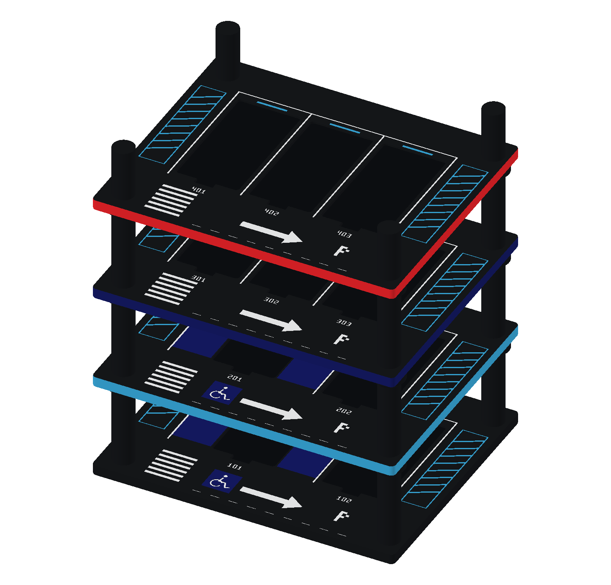

# Simple Parking Lot

四层独立停车架，共 10 个车位。总装尺寸为 195.8 × 158.6 × 228.6 mm，层距为 63 mm。

[FreeCAD 总装](cad/simple-parking-lot.FCStd)包含四层停车板、12 根层间承托柱和 4 根封顶柱。1F 是黑边 101、102 双车位底板，四个 Ø6 mm 定位凸柱与底板一体打印，各高出板面 3 mm。2F、3F、4F 沿用 garage-bookshelf v5 的层板、车位布局和配色。四根 33 mm 封顶柱同样沿用原设计。

## 打印清单

每盘打印一次。3MF 使用 Bambu Lab X2D、0.4 mm 喷嘴和 PLA 配置。

| 盘 | 零件 | 数量 |
| --- | --- | ---: |
| [01](printing/01-1F-101-102-black.3mf) | 1F 黑边底板，101–102 | 1 |
| [02](printing/02-2F-201-202-light-blue.3mf) | 2F 浅蓝边层板，201–202 | 1 |
| [03](printing/03-3F-301-303-dark-blue.3mf) | 3F 深蓝边层板，301–303 | 1 |
| [04](printing/04-4F-401-403-red.3mf) | 4F 红边层板，401–403 | 1 |
| [05](printing/05-support-posts-x12.3mf) | 层间承托柱 | 12 |
| [06](printing/06-top-posts-x4.3mf) | 封顶柱 | 4 |

## 装配

1. 将 1F 底板平放，四根承托柱以底部圆孔套在一体凸柱上，托环和定位销朝上。
2. 将 2F 的四角孔对准承托柱顶销，层板落在四个托环上。依次装上另外两组承托柱和 3F、4F。
3. 在 4F 顶面露出的四个销上套入封顶柱。

总装已检查零件间干涉，六盘 3MF 均已重开切片。实物配合和承载待试装验证。

